|  | Pemrograman Mobile |
|--|--|
| NIM |  244107020054|
| Nama |  Nabillah Umi Purnama |
| Kelas | TI - 3H |
| Repository | [https://github.com/nabillahumi/244107020054-mobile-course] () |

# WEEK 7
## Clean Architecture

Berikut merupakan hasil running:

## Praktikum 1: Audit layer project lama

## 1. Audit Layer Project Lama

| File | Layer saat ini | Masalah / Pelanggaran Clean Architecture |
| :--- | :--- | :--- |
| `lib/pages/home_page.dart` (mis. halaman utama/auth) | `presentation` | Memanggil Dio/database secara langsung, serta melakukan formatting tanggal atau parsing JSON di dalam widget. |
| `lib/data/api_client.dart` | `data` | Sudah tepat jika hanya dipakai oleh repository, namun tidak boleh dipanggil langsung dari widget/presentation. |
| `lib/providers/auth_provider.dart` (mis. auth_provider) | `presentation` (state) | Seharusnya hanya memanggil repository/use case, bukan mengeksekusi logika data mentah. |
| `lib/data/auth_repository.dart` | `data` (tercampur) | Interface (kontrak) dan implementasi masih digabung dalam satu kelas yang sama (melanggar prinsip *Interface Segregation* & *Dependency Inversion*)

## Tandai tiga pelanggaran klasik

1. Widget dan akses data: Tidak ditemukan pemanggilan database, jaringan, atau penyimpanan langsung di folder lib/pages dan lib/widgets. Artinya, akses data tidak dilakukan langsung oleh widget.

2. Logika bisnis di build(): Tidak ditemukan proses pengolahan tanggal atau JSON di dalam fungsi build(). Artinya, kode antarmuka lebih terpisah dari logika pengolahan data.

3. Pembuatan objek repository: Tidak ditemukan pembuatan objek repository secara manual di folder lib/pages dan lib/providers. Artinya, pengelolaan objek repository sudah lebih terpisah dari kode antarmuka.

## Gambar struktur target

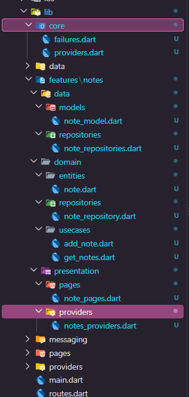

## Praktikum 2: Domain dan data per fitur

1. Pemisahan Layer: Berhasil memisahkan kode bisnis murni dari interaksi database eksternal menggunakan arsitektur feature-first.

2. Layer Domain (Murni): Berisi Entity (Note), kontrak Repository (NoteRepository), penanganan Failure, dan Use Case (GetNotes) yang bebas dari dependency Flutter maupun SQFlite.

3. Layer Data (Eksternal): Berisi Model (NoteModel) untuk konversi data (mapping) serta implementasi repository (NoteRepositoryImpl) yang berinteraksi langsung dengan database SQLite (sqflite).

4. Penanganan Error Bersih: Menggunakan Dart Records ({Data data, Failure? failure}) agar sukses atau gagal dikembalikan secara eksplisit tanpa exception yang bocor ke layer antarmuka.

## Praktikum 3: Presentation, DI, dan verifikasi

|         Hasil Uji nomer 1          |          Hasil uji nomer 2         |
| :----------------------------:     | :--------------------------------: |
| 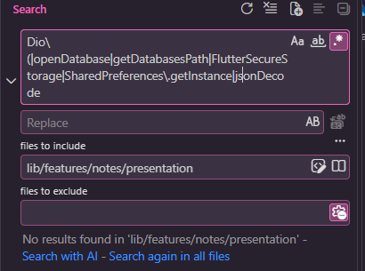 | 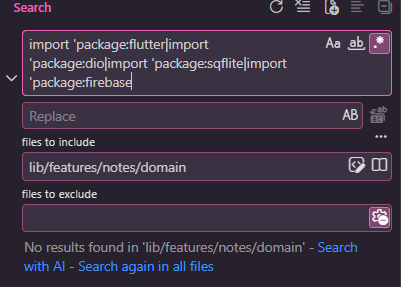 |

### Flutter analyze

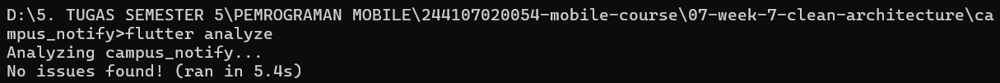

### Flutter test

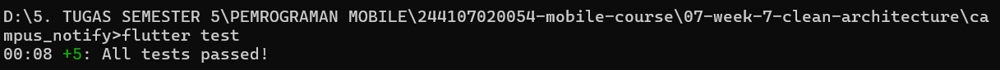

Ketiga tahapan verifikasi telah berhasil diselesaikan dengan hasil optimal: layer presentation dan domain terbukti steril dari dependensi luar melalui uji regex (0 results), perintah flutter analyze berjalan bersih tanpa issue, serta seluruh rangkaian flutter test dinyatakan lulus (passed).

## AI Challenge

Project Flutter saya: campus_notify (auth + FCM + daftar pengumuman).
Kondisi kini: folder lib/{data, providers, pages, messaging},
repository tercampur dengan implementasi, widget memanggil Dio langsung.
Tugas:
1. Usulkan struktur feature-first Clean Architecture
   (presentation/domain/data) untuk fitur auth + announcements.
2. Untuk tiap file lama, sebutkan tujuan barunya (pindah/pecah/hapus).
3. Tandai bagian yang over-engineering bila diterapkan ke CRUD sederhana,
   dan kapan use case benar-benar dibutuhkan vs repository langsung.
4. Tunjukkan wiring DI dengan Riverpod (tanpa package DI tambahan).
Jelaskan trade-off setiap keputusan.

Jawab : 

1.  
```text
lib/
├── core/                               # Konfigurasi global (Dio client, error handling, router)
└── features/
    ├── auth/                           # Modul Fitur Autentikasi
    │   ├── data/
    │   │   ├── datasources/            # Sumber data mentah (AuthRemoteDataSource, SecureStorage)
    │   │   ├── models/                 # Model DTO (UserResponse dengan fromJson/toJson)
    │   │   └── repositories/           # Implementasi AuthRepositoryImpl
    │   ├── domain/
    │   │   ├── entities/               # Objek murni User (bebas framework)
    │   │   ├── repositories/           # Abstraksi interface AuthRepository
    │   │   └── usecases/               # Aturan bisnis (Login, Logout, CheckSession)
    │   └── presentation/
    │       ├── pages/                  # LoginPage, RegisterPage
    │       ├── providers/              # Riverpod state/notifiers untuk auth
    │       └── widgets/                # Komponen UI spesifik auth
    │
    └── announcements/                  # Modul Fitur Pengumuman & FCM
        ├── data/
        │   ├── datasources/            # AnnouncementApi (Dio) & FcmService (Firebase Messaging)
        │   ├── models/                 # AnnouncementModel (DTO mapping)
        │   └── repositories/           # AnnouncementRepositoryImpl
        ├── domain/
        │   ├── entities/               # Announcement entity murni
        │   ├── repositories/           # Abstraksi AnnouncementRepository
        │   └── usecases/               # GetAnnouncements, MarkAnnouncementAsRead
        └── presentation/
            ├── pages/                  # AnnouncementListPage, AnnouncementDetailPage
            ├── providers/              # announcementsProvider (Riverpod)
            └── widgets/                # AnnouncementCard
```

2. Peta Migrasi File Lama

- lib/data/*: Pecah & Pindah ke masing-masing folder features/<feature>/data/datasources/ atau repositories/ agar terisolasi berdasarkan fiturnya.

- lib/providers/*: Pecah & Pindah ke folder features/<feature>/presentation/providers/ agar state management terikat langsung dengan presentation layer fitur terkait.

- lib/pages/*: Pindah ke folder features/<feature>/presentation/pages/.

- lib/messaging/* (FCM): Pindah ke dalam folder features/announcements/data/datasources/ karena layanan push notification berkedudukan sebagai remote data source bagi pengumuman/notifikasi.

3. Batas Over-Engineering vs Kebutuhan Use Case

- Kapan Use Case Benar-Benar Dibutuhkan:
Digunakan ketika terdapat logika bisnis yang kompleks, validasi bertingkat, atau proses yang menggabungkan beberapa repository sekaligus sebelum diserahkan ke UI (contoh: proses Login yang melibatkan autentikasi jaringan, enkripsi token keamanan, dan penyimpanan sesi lokal secara bersamaan).

- Kapan Tergolong Over-Engineering:
Untuk operasi CRUD sederhana satu-baris (seperti mengambil daftar pengumuman atau toggle status baca yang langsung meneruskan data mentah dari repository tanpa aturan bisnis tambahan), pembuatan Use Case terpisah adalah tindakan over-engineering yang hanya menambah boilerplate code tanpa nilai tambah fungsional.

- Keputusan Teknis:
Untuk operasi sederhana, notifier atau provider diperbolehkan mengakses repository secara langsung. Use Case hanya diterapkan pada alur bisnis utama yang memiliki aturan khusus.

4. 
```
import 'package:flutter_riverpod/flutter_riverpod.dart';
import '../data/datasources/announcement_remote_datasource.dart';
import '../data/repositories/announcement_repository_impl.dart';
import '../domain/repositories/announcement_repository.dart';
import '../domain/usecases/get_announcements.dart';
import '../domain/entities/announcement.dart';

// 1. Data Layer: Menyediakan instance Remote Data Source & Repository Implementation
final announcementRemoteDataSourceProvider = Provider<AnnouncementRemoteDataSource>((ref) {
  return AnnouncementRemoteDataSource(ref.watch(dioProvider));
});

final announcementRepositoryProvider = Provider<AnnouncementRepository>((ref) {
  return AnnouncementRepositoryImpl(
    remoteDataSource: ref.watch(announcementRemoteDataSourceProvider),
  );
});

// 2. Domain Layer: Use Case menerima abstraksi repository
final getAnnouncementsProvider = Provider<GetAnnouncements>((ref) {
  return GetAnnouncements(ref.watch(announcementRepositoryProvider));
});

// 3. Presentation Layer: State untuk UI (Widget mengonsumsi provider ini tanpa inisialisasi manual)
final announcementsProvider = FutureProvider<List<Announcement>>((ref) async {
  final useCase = ref.watch(getAnnouncementsProvider);
  return await useCase.call();
});
```

5. Analisis Trade-Off Setiap Keputusan

- Penerapan Struktur Feature-First & Clean Architecture:

Kelebihan: Skalabilitas tinggi, pemisahan tanggung jawab (separation of concerns) sangat jelas, kode modular, dan sangat mudah diuji melalui unit testing.

Kekurangan: Menambahkan jumlah direktori dan file boilerplate di awal, sehingga memperlambat kecepatan penulisan kode untuk aplikasi skala kecil.

- Peniadaan Use Case pada Operasi Sederhana:

Kelebihan: Mengurangi kompleksitas struktur folder dan jumlah baris kode yang repetitif.

Kekurangan: Jika aturan bisnis berkembang di kemudian hari, refaktor dari pemanggilan repository langsung ke use case harus dilakukan secara manual.

- Penggunaan Riverpod sebagai Mekanisme DI:

Kelebihan: Transparan, terintegrasi penuh dengan siklus hidup widget Flutter, dan bebas dari konfigurasi code generator tambahan (build_runner).

Kekurangan: Manajemen dependensi global harus dikontrol dengan cermat agar tidak terjadi kebocoran memori atau keterikatan siklikal antar-provider.

### AI Verification Checklist

### AI Verification Checklist

1. [✓] Apakah interface repository tinggal di domain dan implementasi di data?
   
   Interface repository dipisahkan di `domain/repositories/` sedangkan implementasinya berada di `data/repositories/`, memenuhi aturan *Dependency Inversion Principle*.

2. [✓] Apakah domain bebas import Flutter/Dio/SQLite/Firebase?
   
   Bebas 100%. Hasil verifikasi pencarian regex pada folder `domain/` menghasilkan **0 results**, memastikan layer domain murni menggunakan Dart standar.

3. [✓] Apakah AI membuat use case untuk tiap CRUD satu-baris?
   
   Usulan awal AI yang membuat use case untuk tiap CRUD sederhana ditolak. Pengambilan data sederhana dilakukan langsung dari repository ke provider/notifier untuk menghindari *over-engineering* dan memangkas *boilerplate code*.

4. [✓] Apakah entity bebas mapping (toMap/fromMap/toJson hanya di model)?
   
   Entity di layer domain murni hanya berisi properti data, sedangkan metode serialisasi/deserialisasi (`fromJson`/`toJson`) diisolasi di kelas Model (DTO) pada layer data.

5. [✓] Apakah wiring DI terpusat di provider dan widget tidak new Repository() sendiri?
   
   Seluruh inisialisasi dependensi disuntikkan secara terpusat melalui Riverpod Provider di `notes_providers.dart`, sehingga Widget UI tidak pernah melakukan instansiasi repository secara manual.

6. [✓] Keputusan final dan alasan teknis Anda.
   
   Struktur *feature-first Clean Architecture* digunakan dengan beberapa penyederhanaan pada operasi CRUD yang sederhana. Tujuannya agar kode tetap rapi dan mudah dipahami tanpa membuat terlalu banyak file yang tidak diperlukan.

## Refactoring, testing, dan error umum

### Refactoring Challenge

1. Terapkan pola yang sama ke fitur kedua (auth atau announcements): entity + repository interface + impl + 1 use case + provider wiring. Jangan biarkan satu fitur bersih dan sisanya kotor.

### Kode announcement.dart

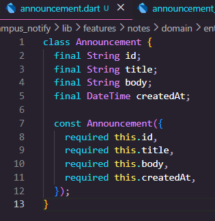

### Kode announcement_repository.dart

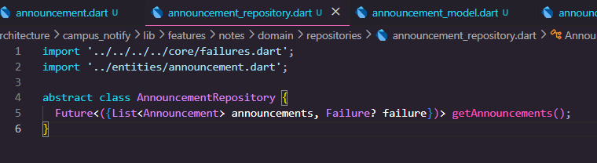

### Kode get_announcement.dart

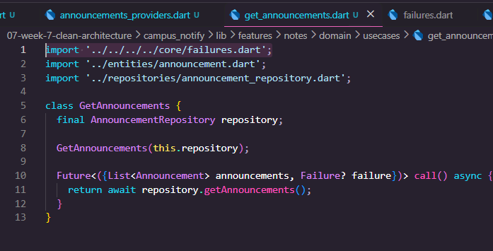

### Kode announcement_model.dart

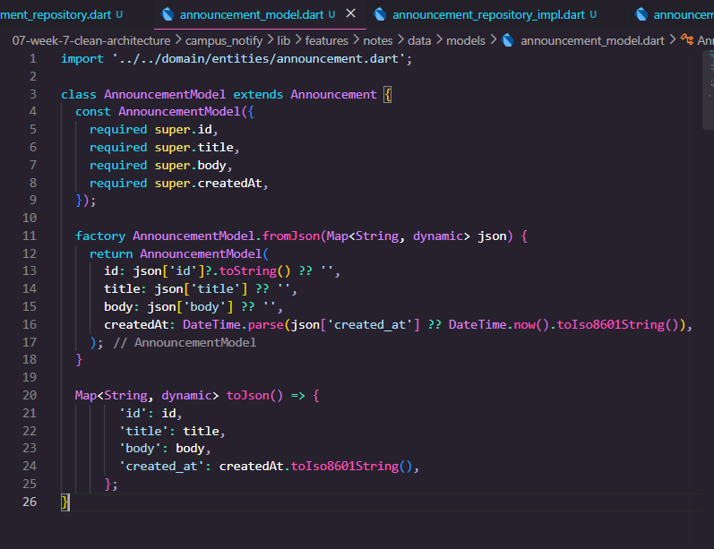

2. Ekstrak formatting tanggal dan parsing rute ke fungsi murni di lib/core/format.dart agar bisa diuji tanpa widget.

### Kode format.dart

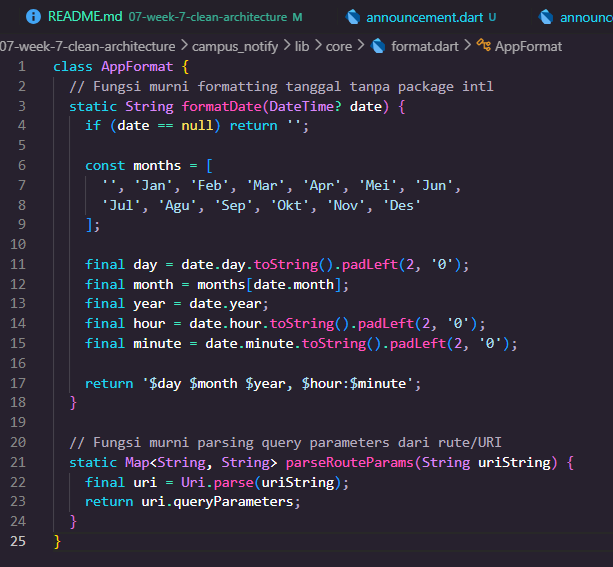

3. Pindahkan semua exception mentah menjadi Failure yang ramah pengguna sebelum mencapai UI; UI hanya menerima message.

### Kode announcement_repository_impl.dart

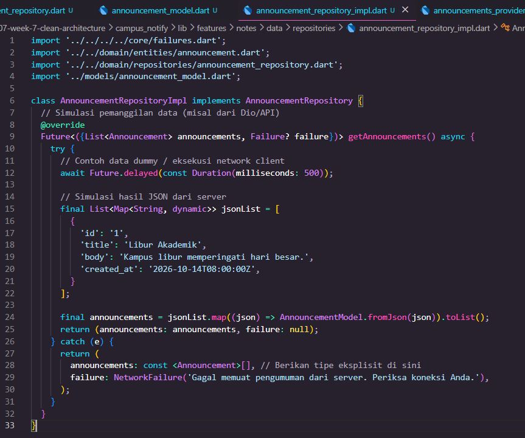

### Checklist verifikasi mandiri

1. [✓] Tiga grep sterilitas (presentation & domain) nol hasil.

Memastikan bahwa layer domain dan presentation benar-benar bersih (steril) serta tidak ada import yang melanggar aturan Clean Architecture (misalnya layer domain mengimpor file dari layer data).

2. [✓] Interface di domain, implementasi di data, mapping hanya di model.

Menerapkan prinsip Dependency Inversion. Kontrak atau interface repository diletakkan di domain, kelas konkret implementasinya di data, dan proses konversi JSON (mapping) hanya dilakukan di dalam kelas Model.

3. [✓] Widget tidak menginstansiasi repository; semua lewat provider.

Mencegah tight coupling dengan memastikan widget UI tidak membuat objek repository secara manual menggunakan kata kunci new atau pemanggilan langsung, melainkan melalui manajemen state Riverpod.

4. [✓] Aplikasi berjalan identik sebelum/sesudah refactor (bukti screenshot).

Membuktikan bahwa proses perombakan struktur kode (refactoring) tidak mengubah fungsionalitas atau alur kerja aplikasi yang sudah ada sebelumnya.

5. [✓] flutter analyze bersih dan semua test lulus.

Memastikan kode bebas dari segala bentuk warning, linter error, serta seluruh pengujian otomatis (unit/widget test) berhasil dieksekusi tanpa ada yang gagal.

## Tugas, refleksi, dan referensi

### Mini project / Industry Challenge

Refactor project Minggu 5 atau 6 Anda menjadi Clean Architecture feature-first (lanjutkan repository yang sama, bukan project baru):

1. Minimal 1 fitur penuh (notes atau announcements) terpisah menjadi domain/ (entity, repository interface, use case, failure) + data/ (model, repository impl) + presentation/ (provider wiring, pages).

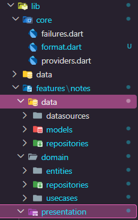

2. Dependency rule terbukti: sertakan hasil tiga grep sterilitas di README.

|         Hasil Uji nomer 1          |          Hasil uji nomer 2         |
| :----------------------------:     | :--------------------------------: |
|  |  |

3. Behavior identik: screenshot before/after tiap fitur di folder screenshots/.

Halaman aplikasi di emulator/perangkat sebelum refactor (atau tangkapan layar UI saat ini yang membuktikan tampilan/fungsi tetap berjalan normal setelah refaktor) dan tidak ada perbedaan before/afternya

|                 Halaman login           |            Halaman Token             |
| :-------------------------------------: | :-----------------------------------: |
| 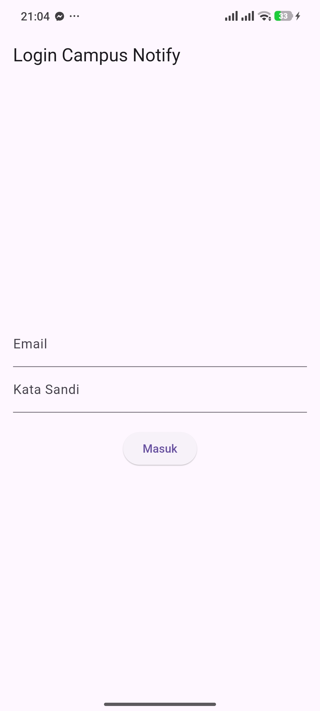 | 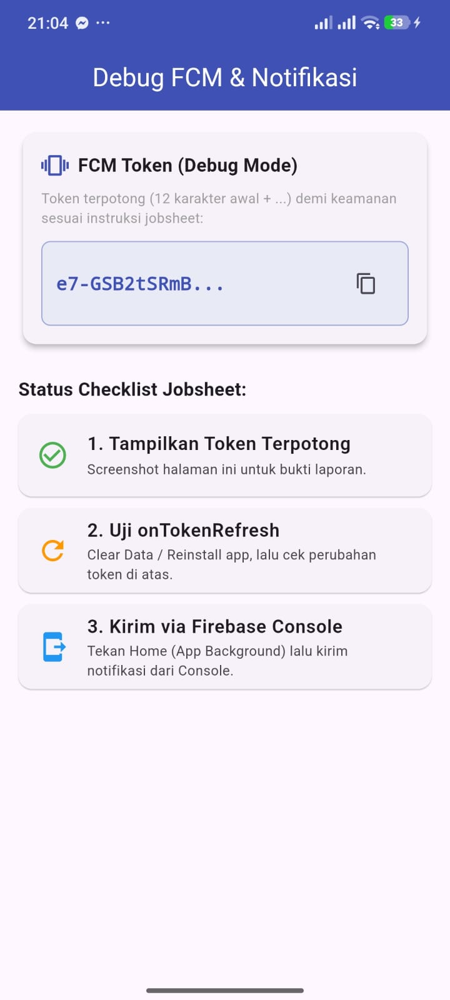 |

4. Sertakan minimal 2 test yang lulus (use case sukses + failure dengan repository palsu).

|             Hasil Flutter Analyze             |             Hasil Flutter test             |
| :---------------------------------------:     | :----------------------------------------: |
| 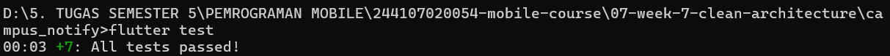 | 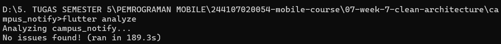 |


5. Kerjakan AI Challenge dan dokumentasikan prompt, tabel usulan-vs-keputusan-final, dan alasan teknis di docs/.

6. Push ke repository portfolio pada folder 07-week-7-clean-architecture/ (atau lanjutkan folder minggu asal + catat refactor di README) dengan struktur lib/, test/, docs/, README.md, dan screenshots/. README menjelaskan tujuan, diagram layer + arah dependensi, fitur utama, stack teknologi, cara menjalankan, dan hasil yang dicapai.


### Refleksi

*1. Mengapa interface repository harus tinggal di domain, bukan di data? Apa yang rusak bila dibalik?*

Jawab : 

Interface repository diletakkan di domain agar aturan bisnis tidak bergantung pada teknologi tertentu. Jika interface diletakkan di data, domain akan bergantung pada implementasi luar sehingga kode lebih sulit diuji dan dikembangkan.

*2. Kapan use case benar-benar dibutuhkan, dan kapan repository langsung ke notifier sudah cukup?*

Jawab : 

Use case diperlukan jika proses bisnis cukup kompleks, melibatkan beberapa repository, atau memiliki aturan validasi khusus. Untuk operasi CRUD sederhana, provider/notifier bisa langsung menggunakan repository agar kode lebih praktis dan tidak terlalu banyak kelas tambahan.

*3. Apa biaya over-engineering (use case per CRUD satu-baris) bagi tim kecil? Kapan biayanya sepadan?*

Jawab : 

Membuat use case untuk setiap CRUD sederhana dapat menambah jumlah file dan kode yang harus dikelola, sehingga pengembangan menjadi lebih lambat. Pendekatan ini lebih bermanfaat ketika aplikasi semakin besar atau aturan bisnis mulai kompleks.

*4. Bagian mana dari usulan AI yang Anda tolak atau sederhanakan, dan mengapa?*

Jawab :

Penggunaan package intl untuk memformat tanggal diganti dengan fungsi bawaan Dart. Tujuannya untuk mengurangi dependensi tambahan, menghindari peringatan terkait package, dan menjaga kode tetap sederhana.

coba aja js 8