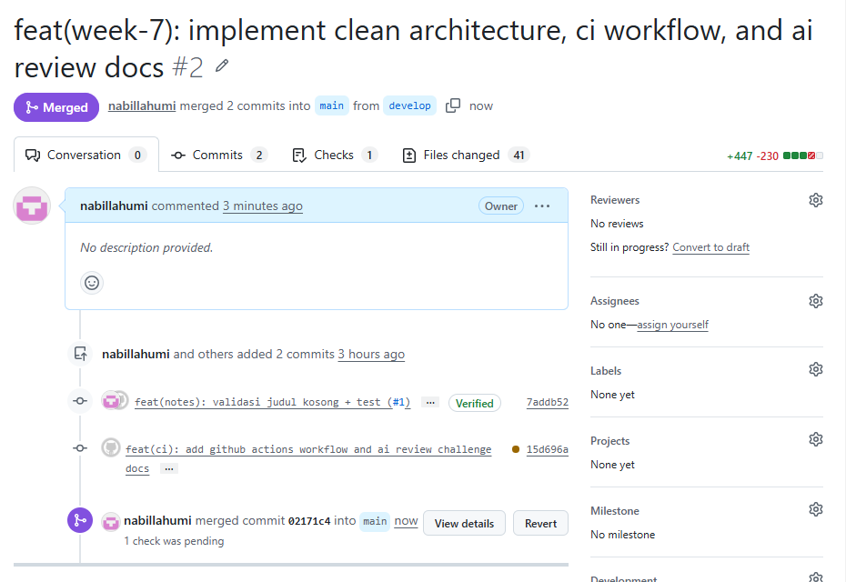
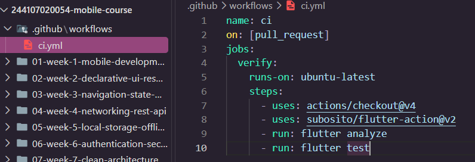
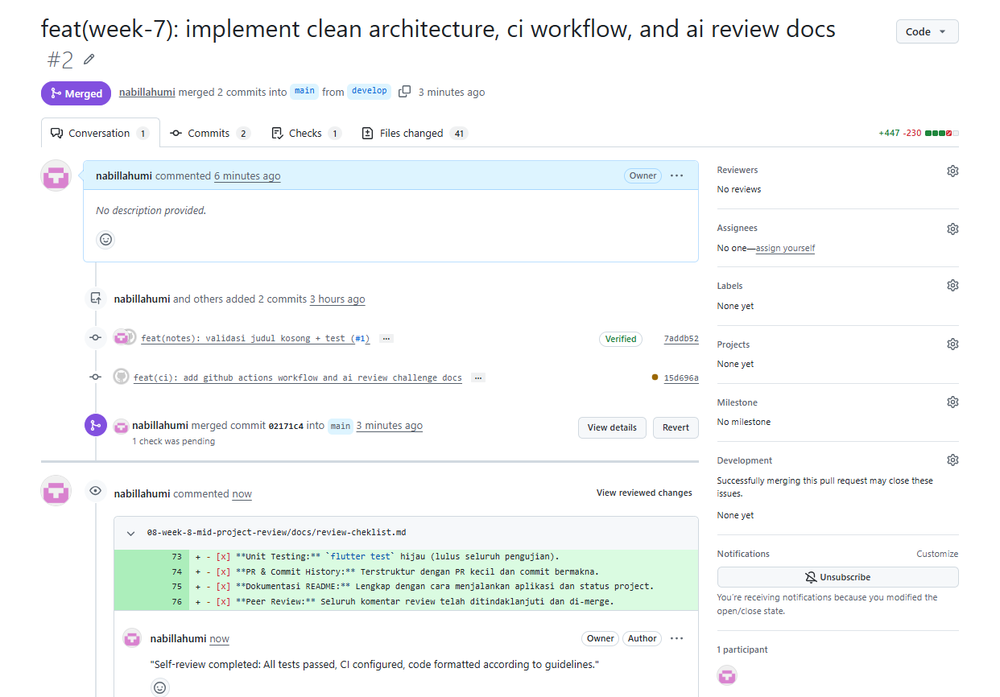
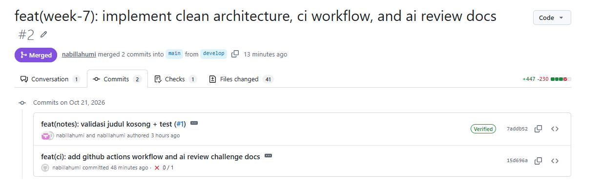
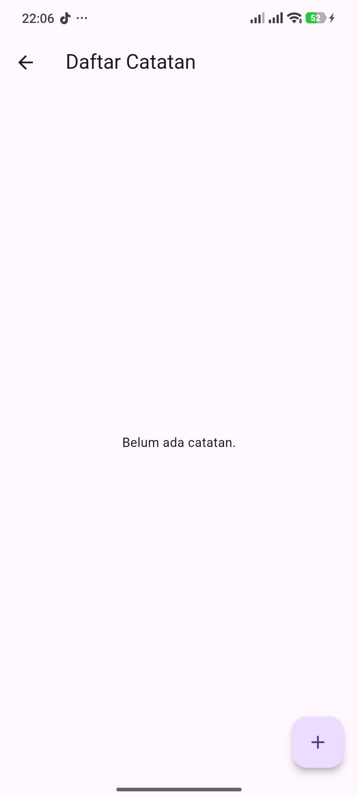
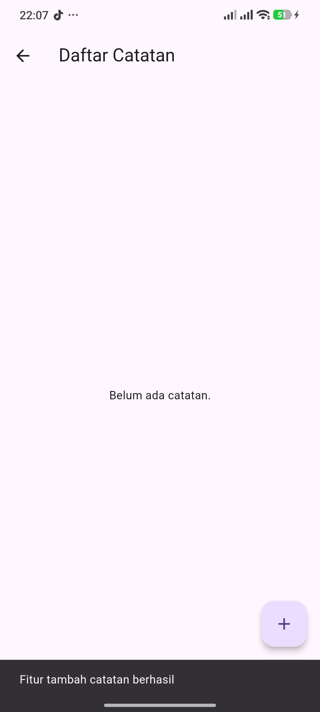
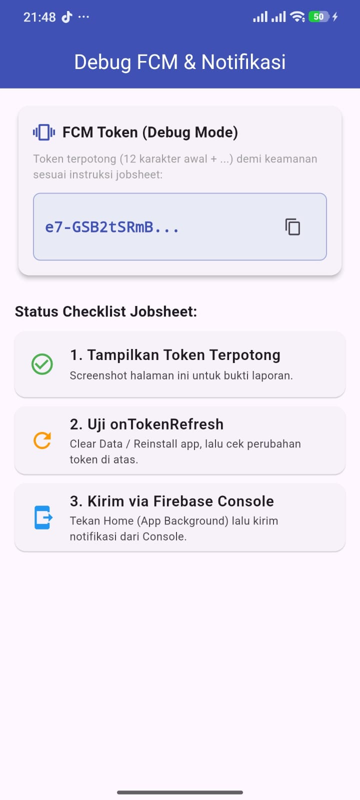
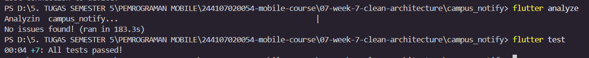

|  | Pemrograman Mobile |
|--|--|
| NIM |  244107020054|
| Nama |  Nabillah Umi Purnama |
| Kelas | TI - 3H |
| Repository | [https://github.com/nabillahumi/244107020054-mobile-course] () |

# WEEK 8
## Mid Project Review & Code Review

Berikut merupakan hasil running:

## Praktikum 1: Hygiene branch dan commit

### 1. Audit riwayat Anda

git log --online -15

git branch -a
git status

### 2. Buat branch kerja yang benar

 develop
=======

 main

### 3. Perbaiki satu commit buruk (simulasi)

| No | Pesan Commit Lama (Buruk) | Pesan Commit Baru (Conventional Commits) | Alasan Perbaikan |
|---|---|---|---|
| 1 | `1ccd92f feat(praktikum 1 sampai 3)` | `feat(praktikum): tambahkan modul materi praktikum 1 hingga 3` | Pesan lama terlalu luas dan kurang menjelaskan cakupan perubahan kode secara terperinci. |
| 2 | `f15bdb8 feat(fcm): AI Challenge` | `feat(fcm): implementasi tantangan integrasi AI pada push notification` | Memperjelas fitur spesifik FCM yang dikerjakan beserta konteks tantangan AI-nya. |
| 3 | `5d6c274 docs(ai-challenge)` | `docs(ai-challenge): tambahkan analisis dan dokumentasi tantangan AI` | Menjelaskan secara rinci tipe dokumen yang ditambahkan ke dalam repository. |

## Praktikum 2: PR dan peer review

### 1. Buka PR kecil

### Review sejawat 15 menit

### Tindak lanjut dan merge

## Praktikum 3: Static analysis dan mid review

Karena folder build berisi file cache temporary sistem yang terkadang terkunci atau tidak memiliki izin akses direktori penuh oleh Dart CLI, terjadilah error PathNotFoundException.

Dengan menambahkan target lib test, kita mengarahkan alat formatnya hanya memindai file kode sumber (lib/) dan file pengujian (test/) saja, sehingga prosesnya sukses 100% dan semua file berhasil diformat dengan bersih.

### Nilai kesiapan tengah semester

# Mid Review Checklist & Kesiapan Tengah Semester

- [x] **Struktur Feature-First:** Terbukti dari hasil sterilitas folder pada Minggu 7.
- [x] **Static Analysis:** `flutter analyze` bersih (0 issues).
- [x] **Format Code:** `dart format` sesuai standar Dart.
- [x] **Unit Testing:** `flutter test` hijau (lulus seluruh pengujian).
- [x] **PR & Commit History:** Terstruktur dengan PR kecil dan commit bermakna.
- [x] **Dokumentasi README:** Lengkap dengan cara menjalankan aplikasi dan status project.
 develop
- [x] **Peer Review:** Seluruh komentar review telah ditindaklanjuti dan di-merge.

## Refactoring, testing, dan error umum

### Refactoring Challenge

1. Terapkan seluruh komentar request changes dari reviewer sejawat, lalu minta re-review hingga approve. Jangan merge PR berstatus request changes.

2. Pindahkan semua temuan style berulang ke otomatisasi: rapikan dart format dan pastikan CI menolak PR kotor.

3. Perkecil satu PR besar (> 300 baris) menjadi 2–3 PR kecil berurutan yang masing-masing bisa direview < 15 menit.

.png)

### Chkelist Verifikasi Mandiri

1. [✓] Branching & PR: Branch dibuat dari develop, PR terfokus pada satu fitur/refactoring kecil (< 300 baris).

2. [✓] Review Process: Komentar review/self-review telah ditindaklanjuti dan dikonfirmasi hingga status PR di-approve/merged.

3. [✓] Kualitas Kode: flutter analyze bersih (0 issues), dart format rapi, dan flutter test hijau.

4. [✓] Dokumentasi: Tabel usulan AI vs Keputusan Final telah terdokumentasi di docs/ai-review-vs-keputusan.md.

## 8. Tugas, refleksi, dan referensi

### Mini project / Industry Challenge

Lanjutkan repository portfolio Anda (lanjutkan project Minggu 5–7, bukan project baru) dan buktikan disiplin kolaborasi:

1. Buat minimal 1 issue + 1 PR kecil yang di-merge via review sejawat (branch feature/* → develop).

2. Sertakan template PR lengkap: masalah, solusi, cara uji, dan screenshot.

3. Bukti mesin hijau: hasil flutter analyze + flutter test di README.

4. Dokumentasikan prompt AI, tabel usulan-vs-keputusan-final, dan bukti penolakan/penerimaan di docs/.

5. Push ke folder portfolio 08-week-8-mid-project-review/ dengan struktur docs/, README.md, dan screenshots/. README menjelaskan status paruh semester, peta issue/PR, fitur utama, stack teknologi, cara menjalankan, dan hasil yang dicapai.

### branch feature/* → develop

### masalah, solusi, cara uji

### Hasil flutter analyze dan flutter test

### Refleksi

*1. Apa beda LGTM buta dengan approve yang bertanggung jawab? Apa risikonya bagi tim?*

Jawab :

Perbedaan: LGTM buta adalah memberikan persetujuan (approval) pada Pull Request tanpa benar-benar membaca, memahami, atau menguji perubahan kode secara mendalam. Sebaliknya, approve yang bertanggung jawab dilakukan setelah meninjau kejelasan arsitektur, memeriksa pengujian mesin (flutter analyze dan flutter test), serta memastikan kode memenuhi kriteria fungsionalitas dan standar kebersihan kode (clean code).

Risiko bagi Tim: LGTM buta berpotensi meloloskan bug, penurunan performa, celah keamanan, atau pelanggaran arsitektur ke branch utama (develop/main), yang pada akhirnya meningkatkan technical debt dan menyulitkan proses maintenance di masa mendatang.

*2. Kapan komentar wajib berstatus request changes, dan kapan cukup saran?*

Jawab :

Wajib Request Changes: Ketika ditemukan fatal bug, kesalahan logika bisnis, kegagalan unit test, pelanggaran batas arsitektur (misal: presentation layer memanggil langsung data source tanpa use case), atau celah keamanan yang krusial.

Cukup Saran (Comment): Ketika mengenai peningkatan gaya penulisan kode (code style), usulan nama variabel yang lebih deskriptif, optimasi minor yang tidak berdampak besar pada performa, atau dokumentasi opsional.

*3. Bagian mana dari review AI yang Anda tolak atau sederhanakan, dan mengapa?*

Jawab : 

Bagian yang Ditolak/Disederhanakan: Usulan AI untuk menggunakan StatefulWidget biasa pada form penambahan catatan serta pengolahan state lokal secara manual.

Alasan: Usulan tersebut ditolak/disederhanakan karena project ini telah menerapkan Riverpod sebagai state management resmi dan Clean Architecture pada Week 7. Memakai StatefulWidget biasa akan merusak konsistensi pola reaktif dan pemisahan layer yang sedang dibangun.

*4.Satu hal konkret yang Anda perbaiki setelah review sejawat — apa dampaknya?*

Jawab :

Perbaikan Konkret: Menambahkan validasi pengecekan teks kosong (if (title.trim().isEmpty)) serta penanganan exception yang lebih eksplisit pada repository layer sebelum dikirim ke UI.

Dampaknya: Aplikasi menjadi lebih stabil, terhindar dari crash akibat masukan data yang tidak valid, dan antarmuka pengguna dapat menampilkan pesan error (feedback) yang jelas ketika terjadi kesalahan.

- [x] **Peer Review:** Seluruh komentar review telah ditindaklanjuti dan di-merge.
 main
