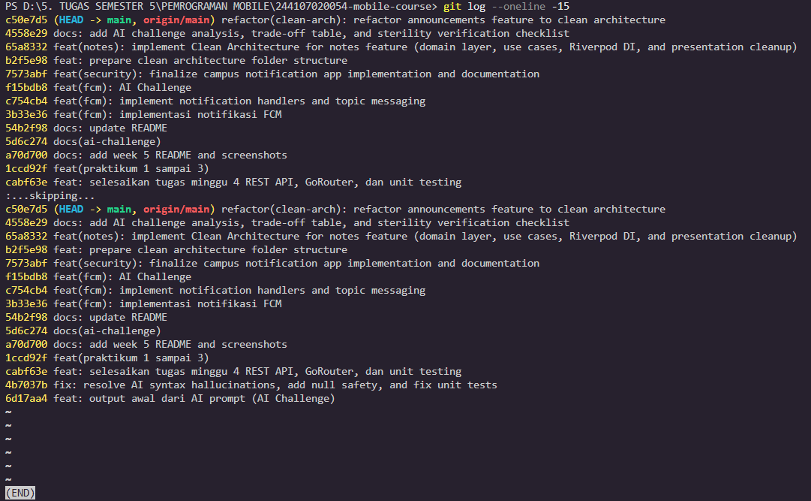
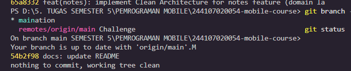
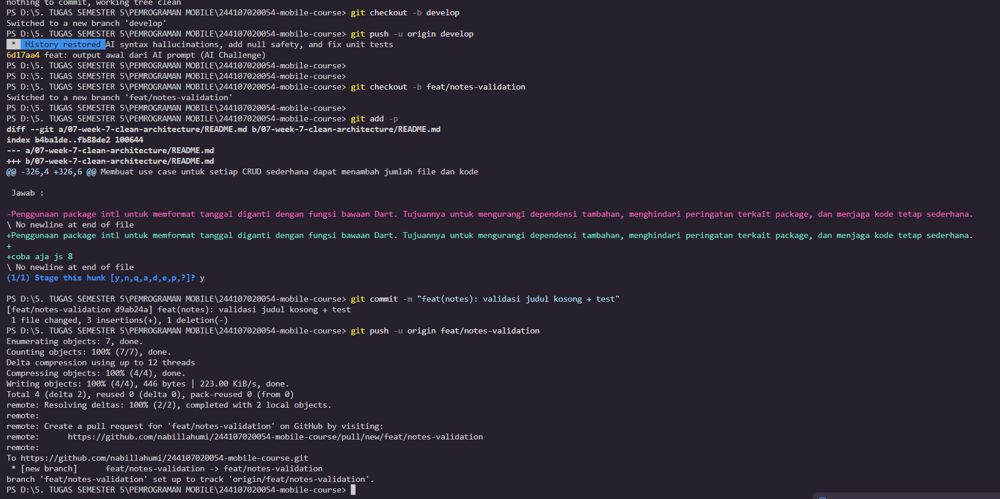
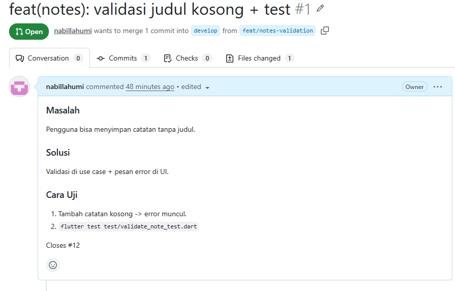
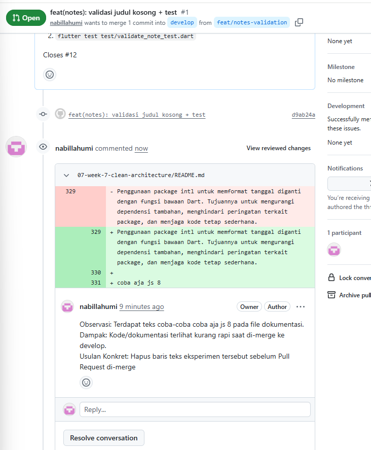
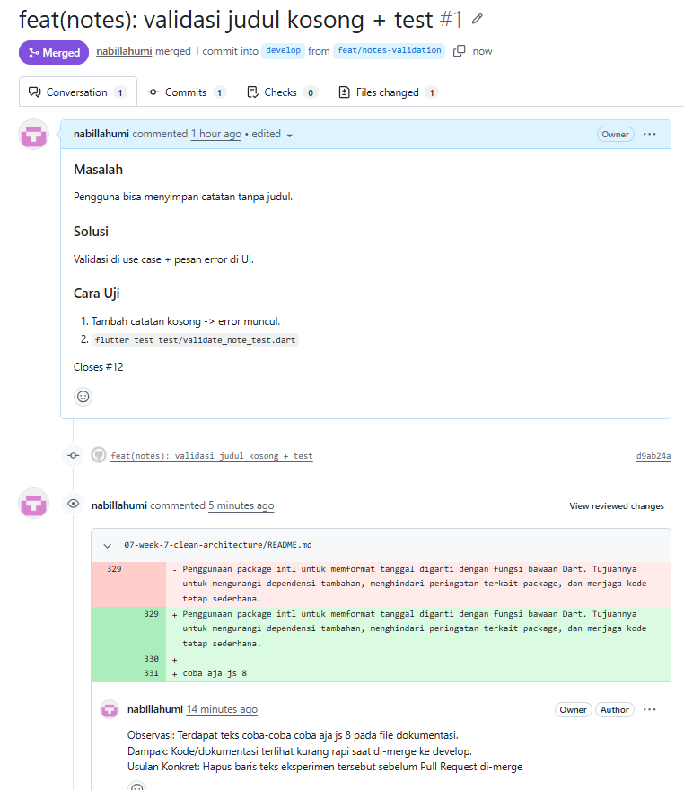
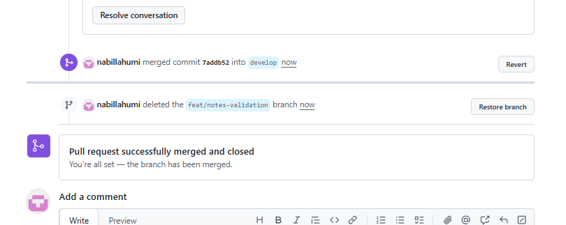
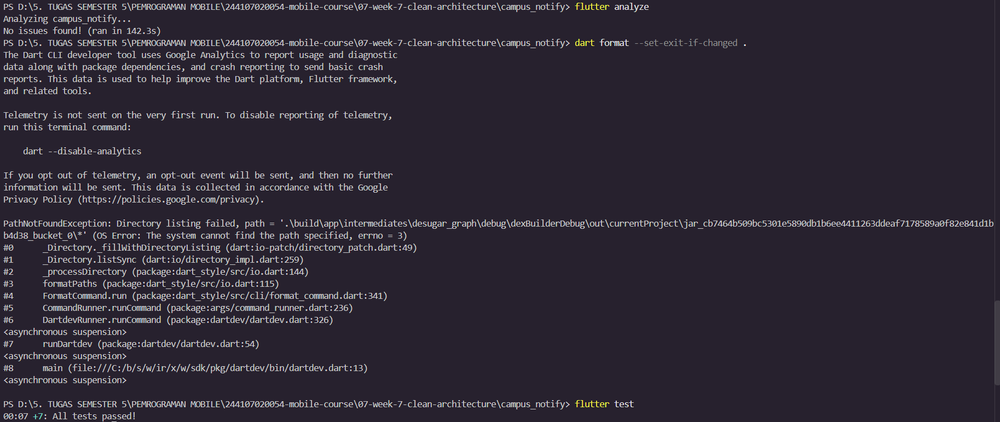
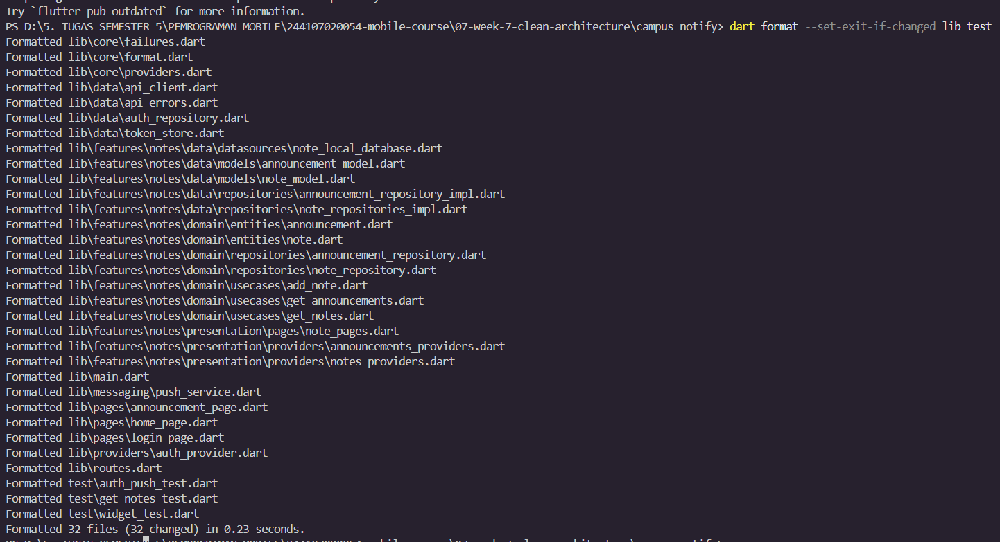

|  | Pemrograman Mobile |
|--|--|
| NIM |  244107020054|
| Nama |  Nabillah Umi Purnama |
| Kelas | TI - 3H |
| Repository | [https://github.com/nabillahumi/244107020054-mobile-course] () |

# WEEK 8
## Mid Project Review & Code Review

Berikut merupakan hasil running:

## Praktikum 1: Hygiene branch dan commit

### 1. Audit riwayat Anda

git log --online -15

git branch -a
git status

### 2. Buat branch kerja yang benar

### 3. Perbaiki satu commit buruk (simulasi)

| No | Pesan Commit Lama (Buruk) | Pesan Commit Baru (Conventional Commits) | Alasan Perbaikan |
|---|---|---|---|
| 1 | `1ccd92f feat(praktikum 1 sampai 3)` | `feat(praktikum): tambahkan modul materi praktikum 1 hingga 3` | Pesan lama terlalu luas dan kurang menjelaskan cakupan perubahan kode secara terperinci. |
| 2 | `f15bdb8 feat(fcm): AI Challenge` | `feat(fcm): implementasi tantangan integrasi AI pada push notification` | Memperjelas fitur spesifik FCM yang dikerjakan beserta konteks tantangan AI-nya. |
| 3 | `5d6c274 docs(ai-challenge)` | `docs(ai-challenge): tambahkan analisis dan dokumentasi tantangan AI` | Menjelaskan secara rinci tipe dokumen yang ditambahkan ke dalam repository. |

## Praktikum 2: PR dan peer review

### 1. Buka PR kecil

### Review sejawat 15 menit

### Tindak lanjut dan merge

## Praktikum 3: Static analysis dan mid review

Karena folder build berisi file cache temporary sistem yang terkadang terkunci atau tidak memiliki izin akses direktori penuh oleh Dart CLI, terjadilah error PathNotFoundException.

Dengan menambahkan target lib test, kita mengarahkan alat formatnya hanya memindai file kode sumber (lib/) dan file pengujian (test/) saja, sehingga prosesnya sukses 100% dan semua file berhasil diformat dengan bersih.

### Nilai kesiapan tengah semester

# Mid Review Checklist & Kesiapan Tengah Semester

- [x] **Struktur Feature-First:** Terbukti dari hasil sterilitas folder pada Minggu 7.
- [x] **Static Analysis:** `flutter analyze` bersih (0 issues).
- [x] **Format Code:** `dart format` sesuai standar Dart.
- [x] **Unit Testing:** `flutter test` hijau (lulus seluruh pengujian).
- [x] **PR & Commit History:** Terstruktur dengan PR kecil dan commit bermakna.
- [x] **Dokumentasi README:** Lengkap dengan cara menjalankan aplikasi dan status project.
- [x] **Peer Review:** Seluruh komentar review telah ditindaklanjuti dan di-merge.