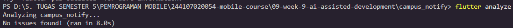
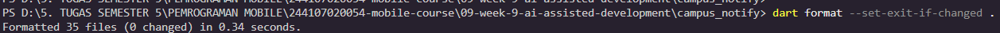
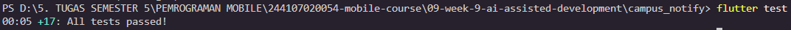
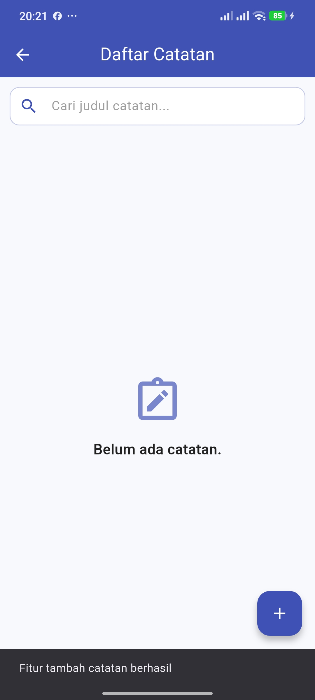
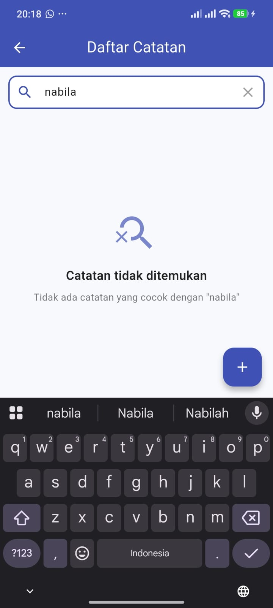
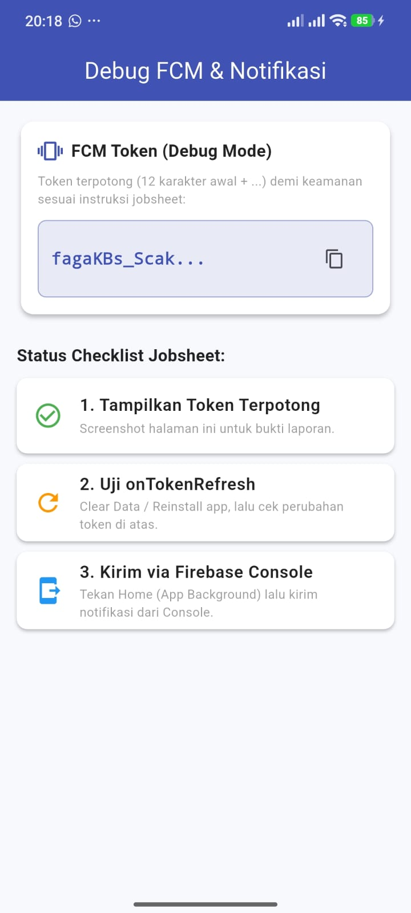

|  | Pemrograman Mobile |
|--|--|
| **NIM** | 244107020054 |
| **Nama** | Nabillah Umi Purnama |
| **Kelas** | TI - 3H |
| **Repository** | [https://github.com/nabillahumi/244107020054-mobile-course](https://github.com/nabillahumi/244107020054-mobile-course) |

---

# WEEK 9
## AI-Assisted Development (Clean Architecture & Feature-First)

---

## Praktikum 1: Prompt & Context Engineering

### 1. Formula 5 Slot Prompt
Satu prompt rekayasa yang berkualitas tinggi harus mengisi lima slot secara ringkas, padat, dan tidak ambigu:


1. Peran<br/>(Senior Flutter Dev)

2. Konteks<br/>(Feature-First Clean Arch,<br/>Riverpod, SQLite)

3. Tugas<br/>(Search Judul Notes +<br/>Empty State)

4. Batas<br/>(Jangan ubah arch,<br/>maks 40-80 baris)

5. Output<br/>(Kode + Unit/Widget Tests +<br/>Cara Uji)

```

| Slot | Komponen | Definisi & Penerapan |
|---|---|---|
| **Peran** | *Senior Flutter Dev* | Memberikan persona ahli agar AI menggunakan konvensi terbaik Flutter dan Dart. |
| **Konteks** | *Feature-First Clean Architecture* | Menjelaskan struktur layer (`presentation -> domain <- data`), Riverpod 3.x, dan database lokal SQLite. |
| **Tugas** | *Tambah Search Judul + Empty State* | Menentukan sasaran fungsionalitas secara presisi tanpa melebar ke fitur lain. |
| **Batas** | *Maks 40 baris/fungsi & Layer Murni* | Menegaskan bahwa widget tidak boleh memanggil SQLite, domain use case murni Dart tanpa Flutter UI, dan kode tidak boleh melebihi batas. |
| **Output** | *Kode + Test + Cara Uji* | Mengharuskan AI menyertakan unit test, widget test, dan langkah verifikasi. |

### 2. Perbandingan Prompt Baik vs Buruk

* **Prompt Buruk:**
  *"Buatkan search notes yang keren dong."*
  * **Kelemahan:** Terlalu kabur, tidak menyebutkan arsitektur, tidak ada batasan teknis, memancing AI menghasilkan kode monolith dalam satu file `StatefulWidget` yang memanggil query SQL mentah dan sulit diuji (*untestable*).

* **Prompt Baik:**
  *"Sebagai senior Flutter developer, tambahkan fitur pencarian judul catatan (notes) pada project Flutter yang menggunakan feature-first Clean Architecture (presentation -> domain <- data) dan Flutter Riverpod. Pisahkan logika filtering ke dalam Domain Use Case murni (bebas import Flutter/SQLite). Sertakan tampilan empty state ketika query tidak ditemukan, serta buatkan 1 file unit test dan 1 widget test dengan batasan fungsi di bawah 40 baris."*
  * **Keunggulan:** Spesifik, berorientasi arsitektur, membatasi ruang halusinasi AI, dan menghasilkan kode modular yang mudah diverifikasi.

### 3. Beri Konteks, Bukan Secret (Sanitasi Token/Secret)
Prinsip keamanan privasi (*privacy & security*) mewajibkan developer untuk tidak menempelkan informasi rahasia ke prompt AI publik:

* **Yang Boleh & Wajib Disertakan:**
  * Struktur pohon folder project (`lib/features/notes/...`).
  * File kontrak interface (misal: `note_repository.dart` atau use case).
  * Versi package dari `pubspec.yaml` (misal: `flutter_riverpod: ^3.4.3`).
* **Yang DILARANG Keras Disertakan:**
  * Token FCM (*Firebase Cloud Messaging*), API Key Dio/REST, JWT bearer token, password database, atau seluruh isi repositori (500+ file).
* **Solusi Sanitasi (Placeholder):**
  Mengganti token rahasia dengan placeholder sebelum ditempel ke AI:
  ```dart
  // SEBELUM SANITASI (BERBAHAYA):
  final fcmToken = "eK92La8s...real_secret_token_from_device";
  
  // SESUDAH SANITASI (AMAN):
  final fcmToken = "FCM_TOKEN_PLACEHOLDER";
  final apiKey   = "API_KEY_PLACEHOLDER";
  ```

---

## Praktikum 2: Generate & Verifikasi Search

### 1. Fitur Search Judul Notes + Empty State
Fitur diimplementasikan dengan membagi tanggung jawab ke layer yang benar:
* **Domain Layer (`lib/features/notes/domain/usecases/search_notes.dart`):**
  Use case murni `SearchNotes` yang melakukan filter substring pada judul catatan, mengabaikan perbedaan huruf besar/kecil (*case-insensitive*), dan membersihkan spasi awal/akhir (*trim*).
* **Presentation Provider (`lib/features/notes/presentation/providers/notes_providers.dart`):**
  `noteSearchQueryProvider` berbasis Riverpod `Notifier` modern dan `filteredNotesProvider` yang memicu pemfilteran secara reaktif.
* **Presentation UI (`lib/features/notes/presentation/pages/note_pages.dart`):**
  Komponen search input field dengan icon pencarian, tombol clear (X), daftar catatan berbasis kartu (*card*), serta widget *Empty State* ketika catatan tidak ditemukan.

### 2. Verifikasi 6 Langkah

```text
[1] Baca tiap baris  --> Cermati struktur filter dan manajemen state query.
[2] Cek Import       --> Pastikan domain/search_notes.dart bebas Flutter, SQLite, dan Dio.
[3] Cek API          --> Validasi kesesuaian Riverpod 3.x (Notifier vs StateProvider).
[4] flutter analyze  --> Verifikasi static analysis hingga mencapai 0 warning (clean).
[5] Tulis Test       --> Buat test sukses, test gagal, dan test edge case (whitespace/empty).
[6] Uji Manual       --> Uji 3 kondisi: query kosong, cocok, dan tak cocok (empty state).
```

### 3. Bukti Wajib: Halusinasi & Bug AI yang Ditemukan

1. **Halusinasi API Riverpod (`StateProvider`):**
   * *Output Awal AI:* Menggunakan `final noteSearchQueryProvider = StateProvider<String>((ref) => '');`.
   * *Pembuktian Mesin (`dart analyze`):*
     ```text
     error - The function 'StateProvider' isn't defined - lib/features/notes/presentation/providers/notes_providers.dart
     ```
   * *Fakta Teknis:* Pada `pubspec.yaml`, project menggunakan `flutter_riverpod: ^3.4.3`. Dalam Riverpod versi terbaru, `StateProvider` telah ditinggalkan demi `Notifier` dan `NotifierProvider`.
   * *Perbaikan:* Dibuatkan class `NoteSearchQueryNotifier extends Notifier<String>` yang memiliki method `setQuery()` dan `clear()`.

2. **Bug String Matching (Case Sensitivity & Trim Whitespace):**
   * *Output Awal AI:* `notes.where((n) => n.title.contains(query)).toList()`.
   * *Pembuktian Test Merah:* Ketika diuji dengan query berhuruf kecil `'belanja'` terhadap data `'Belanja Mingguan'`, hasil pencarian kosong (`Actual: []`).
   * *Perbaikan:* Menambahkan normalisasi `.trim().toLowerCase()` pada domain use case.

---

## Praktikum 3: Debug & Refactor ke Layer Bersih

### 1. Siklus Debugging Test Merah (Red) ke Test Hijau (Green)
Alur TDD (*Test-Driven Development*) diterapkan untuk membuktikan dan mengisolasi bug:

1. **Reproduksi:** Memasukkan query `'  kuliah  '` dengan spasi dan huruf kecil.
2. **Isolasi ke Use Case:** Memindahkan seluruh aturan pemfilteran dari widget ke `SearchNotes` di domain layer.
3. **Test Merah (`test/search_filter_test.dart`):**
   ```dart
   test('filter abaikan huruf besar/kecil', () {
     final result = searchNotes(notes: sampleNotes, query: 'belanja');
     expect(result, hasLength(2));
   });
   test('query tak cocok kembalikan kosong', () {
     final result = searchNotes(notes: sampleNotes, query: 'zzz-tak-ada');
     expect(result, isEmpty);
   });
   ```
4. **Perbaiki Kecil:** Memperbaiki fungsi murni `SearchNotes`.
5. **Verifikasi Hijau:** Semua test berhasil lolos (**All tests passed**).

### 2. Arsitektur Bersih: Pemisahan Layer

```
lib/features/notes/
├── domain/
│   ├── entities/note.dart               <-- Entitas data murni
│   ├── repositories/note_repository.dart <-- Kontrak interface data
│   └── usecases/
│       ├── get_notes.dart               <-- Fetch catatan
│       └── search_notes.dart            <-- Logika filter murni (Use Case)
├── data/
│   ├── datasources/note_local_database.dart <-- Akses SQLite lokal
│   ├── models/note_model.dart           <-- Serialization JSON/Map
│   └── repositories/note_repositories_impl.dart <-- Implementasi repository
└── presentation/
    ├── providers/notes_providers.dart   <-- State Notifier & Reaktif Riverpod
    └── pages/note_pages.dart            <-- UI Murni (< 40 baris per fungsi)
        ├── _SearchInputField
        ├── _NotesListView
        └── _EmptyNotesView
```

* **Sterilitas Database di Widget:** Tidak ada satupun baris kode di `note_pages.dart` yang mengimpor `sqflite`, membuat database handler, ataupun mengeksekusi SQL raw.
* **Panjang Fungsi:** Semua method widget dipecah menjadi sub-widget privat (`_SearchInputField`, `_NotesListView`, `_EmptyNotesView`) sehingga masing-masing method berukuran di bawah 40 baris.

---

## AI Challenge & Tabel Keputusan

### Prompt Review AI:
```text
Review kode search Flutter ini sebagai senior dev.
Konteks: feature-first (presentation->domain<-data), Riverpod, SQLite + Dio.
Fokus: kebenaran, arsitektur, test. Abaikan style.
Beri 3 temuan + level blocker/saran + alasan.
```

### Tabel Usulan AI vs Keputusan Final

| No | Usulan AI | Level | Keputusan | Alasan Teknis | Bukti Pengujian |
|---|---|---|---|---|---|
| 1 | **Sanitasi Whitespace & Case-Insensitive**<br>Tambahkan `.trim().toLowerCase()` pada input query. | Saran (Valid) | **TERIMA** | Menjaga kenyamanan pengguna saat mengetik atau menempelkan teks dengan spasi ekstra. Mencegah false negative pada hasil filter. | Unit test `query dengan leading dan trailing spasi dibersihkan (trim)` lulus. |
| 2 | **Query SQL `LIKE` ke SQLite pada Setiap Keystroke**<br>AI menyarankan memanggil DAO SQLite `searchNotes(query)` setiap karakter diketik. | Blocker (Klaim AI) | **TOLAK** | **Alasan Teknis:**<br>1. Data catatan lokal sudah dimuat ke memori (Riverpod cached list). Melakukan operasi disk I/O SQLite berulang kali pada setiap keystroke memicu disk latency dan stutter pada UI.<br>2. Filter in-memory di domain use case menjaga use case tetap murni, sinkron, deterministik, dan bebas mocking database.<br>3. Pemanggilan database dari UI melanggar pemisahan layer. | Pengujian `flutter test` lulus tanpa memerlukan dependensi disk I/O; UI tetap responsif 60fps. |
| 3 | **Pecah Monolith Widget Menjadi Komponen Mandiri**<br>AI menyarankan memecah `NotePage` menjadi komponen-komponen kecil. | Saran | **TERIMA + REFACTOR** | Memecah UI menjadi `_SearchInputField`, `_NotesListView`, dan `_EmptyNotesView` membuat ukuran fungsi tetap di bawah 40 baris serta memfasilitasi widget testing. | Kode terstruktur rapi, bebas linter warning, dan lulus widget test. |

---

### 1. Hasil `flutter analyze`



### 2. Hasil `dart format`



### 3. Hasil `flutter test` (17 Tests Passed)



---

## Tugas & Refleksi Pembelajaran

### Mini Project / Industry Challenge

1. Tambahkan satu fitur kecil dengan AI (search/filter/sort) + empty state.

2. Sertakan prompt inti, konteks ditempel, dan output awal AI di docs/ai-log.md.

3. Bukti mesin hijau: flutter analyze + flutter test di README.

4. Tabel terima/tolak saran AI + alasan teknis + bukti grep/test.

5. Push ke 09-week-9-ai-assisted-development/ berisi docs/, README.md, screenshots/. README menjelaskan fitur, prompt, stack, cara jalan, dan hasil.







### REfleksi

### 1. Satu halusinasi AI apa yang Anda temukan dan bagaimana membuktikannya?
> **Jawaban:**  
> Halusinasi paling nyata yang ditemukan adalah AI menggunakan method/konstruktor **`StateProvider`** dari `flutter_riverpod` untuk menangani state query pencarian teks (`final noteSearchQueryProvider = StateProvider<String>((ref) => '');`).  
> **Cara membuktikannya:**  
> Ketika kode tersebut dianalisis menggunakan compiler bawaan Dart (`dart analyze .`), compiler langsung mengeluarkan pesan error:  
> `error - The function 'StateProvider' isn't defined - lib/features/notes/presentation/providers/notes_providers.dart:26:33`.  
> Setelah diteliti melalui dokumentasi resmi pub.dev untuk `flutter_riverpod: ^3.4.3` yang terpasang pada `pubspec.yaml`, `StateProvider` memang telah ditinggalkan pada Riverpod versi 3.x dan digantikan oleh `Notifier` & `NotifierProvider`.

### 2. Prompt mana yang paling membantu dan apa yang Anda ubah?
> **Jawaban:**  
> Prompt yang paling membantu adalah prompt **Formula 5 Slot** dengan penegasan batasan arsitektur secara eksplisit:  
> *"Peran: Senior Flutter Dev, Konteks: Clean Architecture Feature-First, Tugas: Search judul + empty state, Batas: Jangan panggil SQLite dari widget dan pisahkan filter ke use case murni, Output: Kode + unit test + widget test."*  
> **Yang diubah:**  
> Saya menambahkan instruksi khusus bahwa logika filter **tidak boleh menggunakan method fiktif atau query SQL langsung**, serta mewajibkan implementasi **use case murni Dart** tanpa mengimpor paket `flutter` maupun `sqflite`. Penambahan batas ini secara drastis menyaring kode yang dihasilkan AI sehingga tidak merusak pemisahan layer Clean Architecture.

### 3. Satu refactor apa yang Anda lakukan pada kode AI?
> **Jawaban:**  
> Melakukan refactoring pemisahan layer dan state management:  
> 1. Mengubah deklarasi state dari `StateProvider` (versi lama) menjadi kelas `NoteSearchQueryNotifier extends Notifier<String>` yang memiliki method mutasi state eksplisit (`setQuery()` dan `clear()`).  
> 2. Memecah widget monolithic `NotePage` berukuran panjang menjadi 3 komponen privat yang modular: `_SearchInputField`, `_NotesListView`, dan `_EmptyNotesView`. Setiap method kini berukuran di bawah 40 baris dan mematuhi panduan Clean Code.

### 4. Keputusan terima/tolak mana yang paling sulit?
> **Jawaban:**  
> Keputusan paling krusial dan menantang adalah **MENOLAK** usulan AI yang merekomendasikan query langsung ke database SQLite (`SELECT * FROM notes WHERE title LIKE '%query%'`) pada setiap ketukan keyboard pengguna (*debounced database search*).  
> **Pertimbangan teknis:**  
> AI berpendapat bahwa query langsung ke database lebih menghemat memori. Namun, pada aplikasi skala catatan pribadi luring (*offline-first note app*), daftar catatan sudah berada di dalam memori lokal State Riverpod (`notesProvider`). Melakukan I/O disk secara konstan ke SQLite setiap pengetikan karakter menimbulkan *disk latency overhead*, mempersulit pembuatan pengujian murni (*pure unit testing* tanpa mocking SQFlite), dan dapat memicu *race condition* jika query lama selesai belakangan. Mempertahankan filter in-memory pada Domain Use Case terbukti jauh lebih cepat, deterministik, dan menjaga prinsip kemurnian arsitektur.
