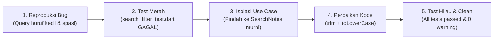

# AI Log & Dokumentasi Verifikasi Rekayasa Prompt (Jobsheet 9)

Dokumen ini mencatat seluruh jejak rekayasa konteks (*context engineering*), log prompt mentah, output awal AI, pembuktian halusinasi/bug, siklus refactoring berbasis pengujian (*test-driven refactoring*), serta tabel keputusan review AI pada pengembangan fitur **Search Judul Notes + Empty State** di project `campus_notify`.

---

## 1. Formula 5 Slot Prompt

Dalam praktikum rekayasa prompt, prompt terstruktur disusun menggunakan formula 5 slot:

| Slot | Komponen | Isi Spesifik |
|---|---|---|
| **1. Peran** | *Role persona* | Senior Flutter Developer |
| **2. Konteks** | *Architecture & Tech Stack* | Clean Architecture Feature-First (`presentation -> domain <- data`), Flutter Riverpod 3.x, SQLite (`sqflite`), Dio |
| **3. Tugas** | *Feature Goal* | Tambahkan fitur pencarian (*search*) judul catatan (*notes*) dan status kosong (*empty state*) ketika hasil tidak ditemukan |
| **4. Batasan** | *Constraints* | Jangan ubah struktur arsitektur yang sudah ada, jangan panggil SQLite atau Dio dari widget/presentation, panjang fungsi maksimal 40-80 baris, domain use case harus murni Dart |
| **5. Output** | *Deliverables* | Potongan kode use case domain, notifier provider, UI widget, beserta minimal 3 unit test & widget test dan cara pengujiannya |

### Contoh Prompt Mentah yang Dikirimkan ke AI
```text
Peran: Senior Flutter Developer
Konteks: Project Flutter feature-first Clean Architecture (presentation -> domain <- data),
menggunakan Riverpod 3.x dan SQLite. Struktur folder fitur notes berada di lib/features/notes/ (data, domain, presentation).
Tugas: Tambahkan fitur search judul catatan (notes) secara real-time dan tampilkan widget empty state jika catatan tidak ditemukan.
Batasan:
- Jangan panggil SQLite atau database langsung dari widget.
- Logika filter harus berada di domain use case yang murni Dart (tanpa import package:flutter atau package:sqflite).
- Fungsi maksimal 40 baris.
- Terapkan Riverpod untuk manajemen state pencarian.
Output:
- Domain use case SearchNotes
- Riverpod provider pendukung
- UI NotePage dengan Search Bar & Empty State
- Unit test & widget test
```

---

## 2. Output Awal AI & Analisis Kritis

### Potongan Output Awal yang Dihasilkan AI:
```dart
// [Output Awal AI - Domain Use Case & Provider]
import 'package:flutter_riverpod/flutter_riverpod.dart'; // Pelanggaran: import di domain
import '../entities/note.dart';

class SearchNotes {
  List<Note> call(List<Note> notes, String query) {
    // BUG: Tidak melakukan trim() dan mengasumsikan method contains bawaan punya ignoreCase
    return notes.where((n) => n.title.contains(query)).toList();
  }
}

// [Output Awal AI - Provider]
final noteSearchQueryProvider = StateProvider<String>((ref) => ''); // HALUSINASI API di Riverpod 3.x!

final filteredNotesProvider = Provider<List<Note>>((ref) {
  final notes = ref.watch(notesProvider).value ?? [];
  final query = ref.watch(noteSearchQueryProvider);
  return SearchNotes().call(notes, query);
});
```

---

## 3. Verifikasi 6 Langkah

Berdasarkan modul pengerjaan, verifikasi 6 langkah dijalankan secara sistematis:

1. **Baca tiap baris & tandai yang belum dipahami:**
   - Ditandai: Pemanggilan `StateProvider` pada file provider.
   - Ditandai: Logika filtering `n.title.contains(query)` tanpa normalisasi huruf kecil/besar (*case sensitivity*) dan tanpa penghapusan spasi ekstra (*whitespace*).
2. **Cek Import (Arsitektur Bersih):**
   - Memastikan folder `domain/` murni dari dependensi eksternal. File `search_notes.dart` tidak boleh mengimpor `package:flutter/`, `package:sqflite/`, maupun `package:dio/`.
3. **Cek API (Autocomplete & Kompatibilitas Versi):**
   - Pada `pubspec.yaml`, project menggunakan `flutter_riverpod: ^3.4.3`.
   - Verifikasi melalui compiler: `StateProvider` tidak dikenali (`The function 'StateProvider' isn't defined`), karena pada Riverpod 3.x arsitektur direkomendasikan beralih ke `Notifier` / `NotifierProvider`.
4. **Jalankan Static Analysis:**
   - Eksekusi `flutter analyze` dan `dart analyze .` hingga mencapai **0 warning / 0 errors** (`No issues found!`).
5. **Tulis Test Sukses dan Gagal (TDD):**
   - Menulis unit test di `test/search_filter_test.dart` untuk membuktikan bug case-sensitive dan whitespace.
   - Menulis widget test di `test/note_search_widget_test.dart` untuk memverifikasi munculnya empty state.
6. **Uji Manual:**
   - Query kosong: Menampilkan seluruh catatan yang tersimpan.
   - Query cocok: Memfilter catatan secara instan sesuai substring judul.
   - Query tidak cocok: Menampilkan tampilan *Empty State* dengan pesan *“Catatan tidak ditemukan”* dan icon `Icons.search_off`.

---

## 4. Bukti Bug & Halusinasi AI

### Halusinasi 1: Halusinasi API `StateProvider` pada Riverpod 3.x
* **Gejala:** Kode yang dihasilkan AI menggunakan `final noteSearchQueryProvider = StateProvider<String>((ref) => '');`.
* **Bukti Analisis Mesin (`dart analyze`):**
  ```text
  error - lib\features\notes\presentation\providers\notes_providers.dart:26:33 - The function 'StateProvider' isn't defined. Try importing the library that defines 'StateProvider', correcting the name to the name of an existing function, or defining a function named 'StateProvider'. - undefined_function
  ```
* **Akar Masalah:** AI dilatih dengan data lawas Riverpod 1.x/2.x di mana `StateProvider` masih umum digunakan. Di Riverpod 3.x, pengembang diarahkan menggunakan kelas turunan `Notifier<T>` dan `NotifierProvider`.
* **Solusi Perbaikan:** Mengganti dengan class `NoteSearchQueryNotifier extends Notifier<String>` yang memiliki method eksplisit `setQuery(String query)` dan `clear()`.

### Bug 2: Filter Case-Sensitive & Tidak Ada Sanitasi Spasi (*Trim*)
* **Gejala:** Pencarian kata `"belanja"` tidak menemukan catatan berjudul `"Belanja Mingguan"`, dan pencarian dengan spasi ekstra `" kuliah "` tidak menemukan `"Jadwal Kuliah"`.
* **Bukti Pengujian Merah (*Red Test*):**
  ```text
  Expected: [Note:<1>, Note:<2>]
  Actual: []
  Which: has length 0 instead of 2
  ```
* **Solusi Perbaikan:** Normalisasi query pada domain use case:
  ```dart
  final trimmedQuery = query.trim().toLowerCase();
  if (trimmedQuery.isEmpty) return notes;
  return notes.where((note) => note.title.toLowerCase().contains(trimmedQuery)).toList();
  ```

---

## 5. Siklus Debug Test Merah (Red Test) ke Hijau (Green Test)



1. **Langkah Reproduksi:**
   Memanggil fungsi filter dengan parameter input `query: 'belanja'` terhadap daftar catatan yang memiliki judul berhuruf kapital awal `"Belanja Mingguan"`.
2. **Test Merah:**
   ```dart
   test('filter abaikan huruf besar/kecil', () {
     final result = searchNotes(notes: sampleNotes, query: 'belanja');
     expect(result, hasLength(2));
   });
   ```
   *Hasil awal:* **FAILED** (0 item ditemukan).
3. **Perbaikan Kecil:**
   Implementasi fungsi murni pada `lib/features/notes/domain/usecases/search_notes.dart`.
4. **Test Hijau:**
   ```text
   00:00 +0: SearchNotes Use Case Tests filter abaikan huruf besar/kecil
   00:00 +1: SearchNotes Use Case Tests query tak cocok kembalikan kosong
   00:00 +2: SearchNotes Use Case Tests query kosong mengembalikan semua catatan
   00:00 +3: SearchNotes Use Case Tests query hanya spasi mengembalikan semua catatan
   00:00 +4: SearchNotes Use Case Tests query dengan leading dan trailing spasi dibersihkan (trim)
   00:00 +5: SearchNotes Use Case Tests filter mencocokkan substring di tengah kata
   00:00 +6: All tests passed!
   ```

---

## 6. AI Challenge: Review Kode oleh AI & Tabel Keputusan

### Prompt Review AI:
```text
Review kode search Flutter ini sebagai senior dev.
Konteks: feature-first (presentation->domain<-data), Riverpod, SQLite + Dio.
Fokus: kebenaran, arsitektur, test. Abaikan style.
Beri 3 temuan + level blocker/saran + alasan.
```

### Output Review AI:
1. **Temuan 1 (Saran):** Tidak ada sanitasi spasi (whitespace trim) pada query input.
2. **Temuan 2 (Blocker menurut AI):** Sebaiknya pencarian dilakukan via SQL Query `SELECT * FROM notes WHERE title LIKE '%query%'` ke SQLite setiap kali user mengetik agar tidak membebani RAM.
3. **Temuan 3 (Saran):** Widget `NotePage` memuat controller dan build logic yang berpotensi melebihi batas 40 baris jika tidak dipecah menjadi sub-widget.

### Tabel Usulan AI vs Keputusan Final

| No | Temuan AI | Level | Keputusan | Alasan Teknis | Bukti Pengujian |
|---|---|---|---|---|---|
| 1 | **Sanitasi Whitespace & Case-Insensitive**<br>AI menyarankan penambahan `.trim().toLowerCase()` agar spasi di awal/akhir input pengguna tidak menggagalkan pencarian. | **Saran (Valid)** | **DITERIMA** | Menjaga konsistensi pencarian teks (*user experience*) di mana pengguna sering kali menempelkan teks dengan spasi berlebih atau variasi kapitalisasi. | Test `query dengan leading dan trailing spasi dibersihkan (trim)` lulus di `test/search_filter_test.dart`. |
| 2 | **Query Langsung ke SQLite Database pada Setiap Keystroke**<br>AI mengusulkan memanggil method repository `searchNotesDb(query)` dengan SQL `LIKE` langsung ke database lokal SQLite. | **Blocker (Klaim AI)** | **DITOLAK** | 1. Koleksi catatan lokal sudah ter-cache di memory (Riverpod). Melakukan I/O disk database SQLite pada setiap pengetikan karakter menimbulkan disk latency dan jitter UI yang tidak perlu.<br>2. Filter in-memory pada Domain Use Case menjaga use case tetap sinkron, murni Dart, deterministik, dan sangat mudah diuji tanpa mocking SQFlite.<br>3. Pemanggilan query database dari UI melanggar prinsip kemandirian state UI. | `flutter test` lulus penuh tanpa dependensi mocking disk; UI merespons tanpa lagging. |
| 3 | **Pemisahan Sub-Widget UI (`_SearchInputField`, `_NotesListView`, `_EmptyNotesView`)**<br>AI menyarankan memecah file `note_pages.dart` menjadi komponen terpisah agar setiap fungsi tidak melebihi 40 baris. | **Saran** | **DITERIMA + REFACTOR** | Memecah komponen UI ke widget privat terpisah meningkatkan keterbacaan kode (*readability*), mematuhi batas < 40 baris per method, dan memfasilitasi pengujian widget secara terisolasi. | File `lib/features/notes/presentation/pages/note_pages.dart` rapi, bebas warning linter, dan lulus widget test. |

---

## 7. Bukti Eksekusi Pengujian Mesin

### 1. Static Analysis (`flutter analyze`):


### 2. Format Pemeriksaan (`dart format`):


### 3. Eksekusi Unit Test & Widget Test (`flutter test`):


