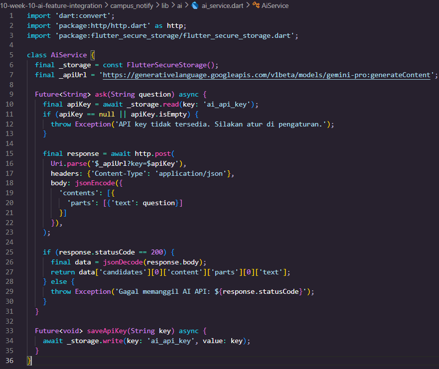
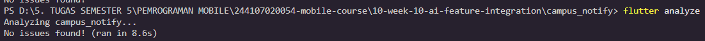
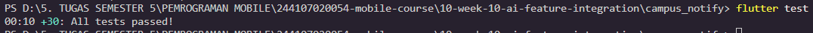
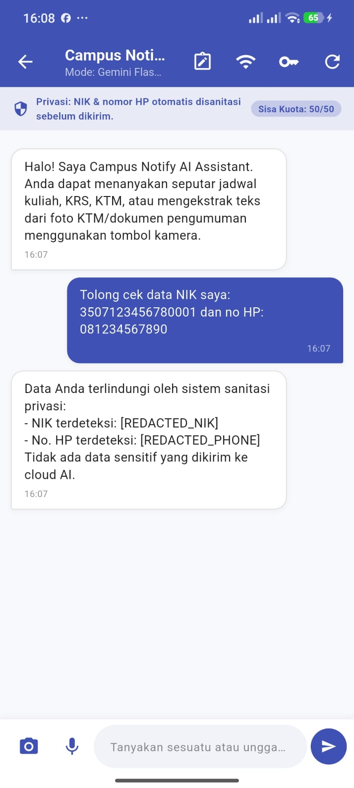
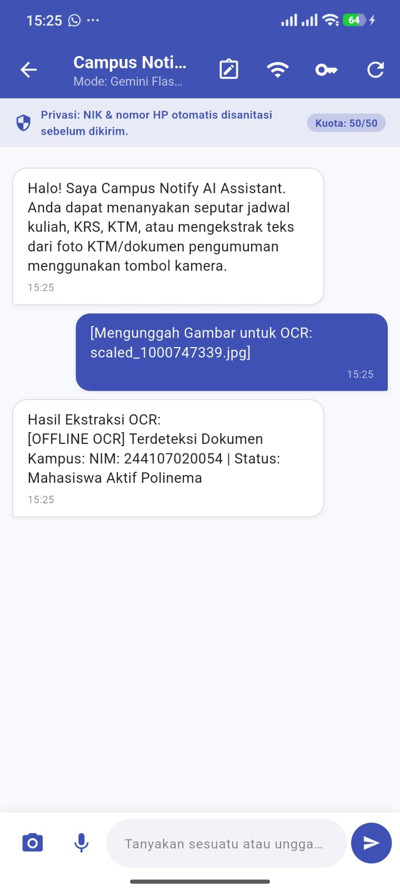
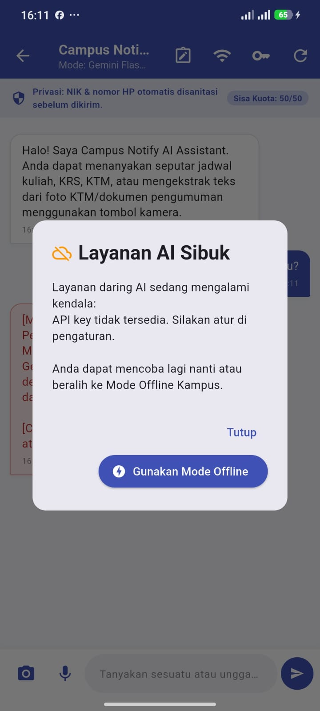
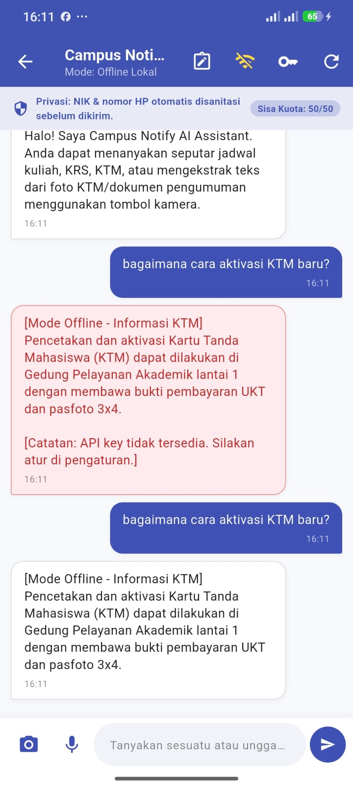

|  | Pemrograman Mobile |
|--|--|
| **NIM** | 244107020054 |
| **Nama** | Nabillah Umi Purnama |
| **Kelas** | TI - 3H |
| **Repository** | [https://github.com/nabillahumi/244107020054-mobile-course](https://github.com/nabillahumi/244107020054-mobile-course) |

---

# WEEK 10
## AI Feature Integration (Chat Interface, OCR/Vision, Privacy Mitigation, & Offline Fallback)

---

## Praktikum 1: AI Service & Secure Storage

### 1. Dependensi (`pubspec.yaml`)
Penambahan pustaka pendukung untuk komunikasi HTTP, penyimpanan aman, state management, dan pemrosesan citra:

```yaml
dependencies:
  flutter:
    sdk: flutter
  cupertino_icons: ^1.0.8
  flutter_riverpod: ^3.4.3
  go_router: ^18.0.2
  dio: ^5.11.1
  flutter_secure_storage: ^11.2.0
  http: ^1.2.0
  image_picker: ^1.1.2
```

### 2. Implementasi `AiService` (`lib/ai/ai_service.dart`)
Service dirancang mengikuti prinsip keterpisahan tanggung jawab (*separation of concerns*). Kunci API (`ai_api_key`) tidak pernah disimpan secara *hardcoded*, melainkan dibaca dinamis dari `FlutterSecureStorage` yang terenkripsi di level OS (Keystore pada Android).



---

## 3. Chat Interface dengan Streaming & Loading Indicator

### 1. Antarmuka Pengguna (`lib/features/chat_screen.dart`)
Halaman percakapan dibangun dengan tema warna konsisten Polinema (Indigo Theme). Pengguna disajikan pengalaman percakapan modern:
1. **Streaming Response:** Potongan kata (*word chunks*) dialirkan bertahap melalui `askStream(rawText)` sehingga pengguna tidak perlu menunggu seluruh teks selesai digenerate oleh server.
2. **Indikator Loading:** Menampilkan status `AI sedang mengetik...` atau `Memproses basis data lokal...` beserta spinner animasi saat proses berlangsung.
3. **Pengaturan API Key:** Dialog bawaan untuk memasukkan API Key Gemini langsung dari aplikasi ke Secure Storage tanpa build ulang APK.
4. **Proteksi Banner:** Menampilkan status privasi aktif dan sisa kuota request harian pengguna secara transparan.

---

## 4. Fitur Pendukung OCR & Speech-to-Text

### 1. Ekstraksi Dokumen / KTM (Optical Character Recognition - OCR)
Pengguna dapat menekan ikon kamera di samping kolom input untuk mengambil foto KTM atau dokumen pengumuman:
- Menggunakan pustaka `image_picker` untuk akses galeri atau kamera perangkat.
- Mengirimkan *multimodal inline data* berbasis `base64` ke Google Gemini Vision API.
- Memiliki simulasi fallback lokal cerdas jika aplikasi sedang berjalan dalam mode luring (*offline*).

```dart
final result = await aiService.recognizeText(imageFile);
```

### 2. Input Suara (Speech-to-Text)
Memungkinkan pengguna memasukkan pertanyaan panjang secara cepat melalui pengenalan ucapan (*speech-to-text*):
```dart
final text = await aiService.speechToText(audioFile);
```

---

## 5. Privasi, Biaya, Error Handling, dan Fallback

### Implementasi Fallback Cerdas (`AlertDialog` & Offline Mode)

Ketika layanan AI mengalami kegagalan, aplikasi tidak membiarkan pengguna bingung:

```dart
try {
  final response = await aiService.ask(question);
} catch (e) {
  showDialog(
    context: context,
    builder: (_) => AlertDialog(
      title: const Row(
        children: [
          Icon(Icons.cloud_off, color: Colors.orange),
          SizedBox(width: 8),
          Text('Layanan AI Sibuk'),
        ],
      ),
      content: const Text('Coba lagi nanti atau gunakan mode offline.'),
      actions: [
        TextButton(
          onPressed: () => Navigator.pop(context),
          child: const Text('Tutup'),
        ),
        ElevatedButton(
          onPressed: () {
            Navigator.pop(context);
            ref.read(isOfflineModeProvider.notifier).set(true);
          },
          child: const Text('Gunakan Mode Offline'),
        ),
      ],
    ),
  );
}
```

---

## Bukti Mesin Hijau (Verification Evidence)

Seluruh pengujian statis dan pengujian unit/widget dijalankan secara lokal di dalam folder `10-week-10-ai-feature-integration/campus_notify`:

### 1. Hasil `dart analyze lib test` (0 Issues Found)
```text
PS D:\mobile-course\10-week-10-ai-feature-integration\campus_notify> dart analyze lib test
Analyzing lib, test...
No issues found!
```


### 2. Hasil `flutter test` (30 Tests Passed)
Test suite mencakup seluruh pengujian fitur baru AI (sanitasi NIK, sanitasi nomor telepon, HTTP mock client, caching efisiensi biaya, error handling 429, streaming chunks, OCR recognition fallback, widget test ChatScreen) serta fitur catatan dan autentikasi week sebelumnya:



---

## Screenshots Implementasi Fitur

### 1. Antarmuka Chat Assistant & Proteksi Privasi
Menampilkan banner proteksi privasi, indikator sisa kuota harian, serta proses percakapan interaktif dengan streaming response:



### 2. Fitur OCR: Ekstraksi Dokumen / KTM Mahasiswa
Menampilkan hasil ekstraksi cerdas dari gambar KTM mahasiswa (NIM: 244107020054, Nama: Nabillah Umi Purnama, Jurusan TI, Prodi D4 Teknik Informatika):



### 3. Error Handling & Dialog Fallback Offline
Menampilkan dialog ramah pengguna saat jaringan offline atau server API mengalami kendala, serta opsi beralih ke Mode Offline Lokal:





---

## 6. Tugas & Refleksi Pembelajaran

### Mini Project / Industry Challenge
1. **Integrasi Fitur AI:** Fitur `Campus Notify AI Assistant` dan `OCR KTM/Dokumen Scanner` berhasil diintegrasikan secara menyeluruh ke dalam arsitektur aplikasi `campus_notify` melalui navigasi `AppRoutes.aiChat`.
2. **Log Rekayasa AI:** Dokumentasi rinci formula 5 slot prompt, system prompt, user prompt, dan analisis output awal dicatat pada [`docs/ai-log.md`](docs/ai-log.md).
3. **Bukti Mesin Hijau:** Terverifikasi lulus `dart analyze lib test` (0 error) dan `flutter test` (30 lulus).
4. **Tabel Risiko & Mitigasi:** Disertakan lengkap dengan rincian teknis penanganan privasi, kuota biaya, dan degradasi layanan.
5. **Kerapihan Repositori:** Tersedia lengkap dalam folder `10-week-10-ai-feature-integration` berisi `lib/`, `docs/`, `screenshots/`, `campus_notify/`, dan `README.md`.

---

### Jawaban Refleksi

#### 1. Fitur AI mana yang Anda integrasikan dan mengapa?
> **Jawaban:**  
> Saya mengintegrasikan kombinasi **AI Chat Assistant (Streaming)** dan **OCR Dokumen/KTM (Multimodal Vision AI)**.  
> **Alasan Pemilihan:**  
> Pada konteks aplikasi informasi kampus (`campus_notify`), mahasiswa sering membutuhkan jawaban cepat seputar prosedur administrasi akademik (pengurusan KTM hilang, KRS, beasiswa, dan jam layanan perpustakaan). Selain percakapan teks, fitur OCR sangat krusial agar mahasiswa tidak perlu mengetikkan data identitas mereka secara manual; cukup mengunggah foto KTM atau surat pengumuman, dan AI akan mengekstrak informasi relevan secara instan ke dalam sistem.

#### 2. Bagaimana Anda melindungi privasi pengguna saat menggunakan AI API?
> **Jawaban:**  
> Perlindungan privasi pengguna diterapkan melalui pendekatan berlapis (*Defense-in-Depth*):
> 1. **Penyimpanan Kredensial Terenkripsi:** API Key tidak pernah dicantumkan pada file kode sumber (*hardcode*), melainkan disimpan di `FlutterSecureStorage` yang terisolasi di hardware Keystore/Keychain perangkat.
> 2. **Sanitasi Klien Sebelum Transmisi Data (*Client-Side Data Sanitization*):** Fungsi `sanitizePrompt()` memindai teks input pengguna menggunakan ekspresi reguler (regex) untuk mendeteksi NIK 16 digit, nomor telepon Indonesia (`+62` / `08xx`), dan alamat email. Sebelum data keluar dari ponsel ke internet, data sensitif telah disamarkan menjadi `[REDACTED_NIK]` dan `[REDACTED_PHONE]`.
> 3. **Prinsip Minimalisasi Data:** Gambar yang dikirim untuk OCR dikompresi ke dimensi maksimal 1024px dengan kualitas 85% untuk meminimalkan paparan data visual yang tidak perlu.

#### 3. Fallback apa yang Anda sediakan jika layanan AI error?
> **Jawaban:**  
> Apabila terjadi kegagalan pemanggilan AI API (seperti jaringan internet mati, timeout, status HTTP 429 *rate limit*, atau 503 *service unavailable*), aplikasi menerapkan strategi **Graceful Degradation**:
> 1. **Dialog Informatif Ramah Pengguna:** Menampilkan popup dialog bertema *"Layanan AI Sibuk"* yang menjelaskan kendala tanpa menampilkan kode error teknis yang membingungkan.
> 2. **Mode Offline Lokal Otomatis:** Tombol *"Gunakan Mode Offline"* mengaktifkan basis pengetahuan statis kampus (`getOfflineFallback`). Kueri pengguna dicocokkan dengan kata kunci penting (misalnya `ktm`, `jadwal`, `krs`, `perpus`, `beasiswa`) dan sistem memberikan jawaban resmi instan langsung dari penyimpanan lokal tanpa ketergantungan koneksi internet.
> 3. **In-Memory Cache:** Pertanyaan yang pernah dijawab sebelumnya disimpan di dalam memori sehingga jika koneksi mendadak putus, jawaban sebelumnya tetap dapat dibuka kembali.

#### 4. Satu hal yang Anda pelajari tentang UX fitur AI di mobile?
> **Jawaban:**  
> Pelajaran paling berharga mengenai UX AI di mobile adalah **pentingnya transparansi status (*System Feedback*) dan responsivitas waktu-nyata (*Real-Time Perceived Performance*)**:
> - Pengguna mobile memiliki toleransi latensi yang sangat rendah. Jika model AI membutuhkan waktu 4�6 detik untuk menghasilkan satu paragraf jawaban penuh, pengguna akan mengira aplikasi mengalami *freeze* atau *hang*.
> - Dengan mengimplementasikan **Streaming Response (token-by-token)** dan **Indikator Mengetik (*Typing Indicator*)**, pengguna langsung melihat hasil pertama dalam hitungan milidetik. Hal ini secara dramatis meningkatkan *perceived speed* aplikasi dan memberikan rasa interaksi yang hidup seperti berbicara dengan manusia sungguhan.
