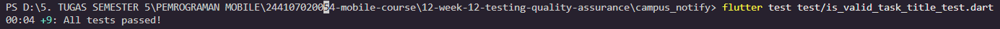
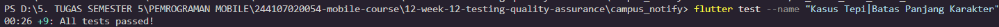
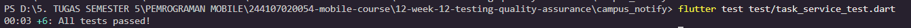
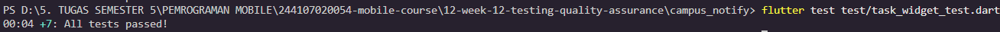
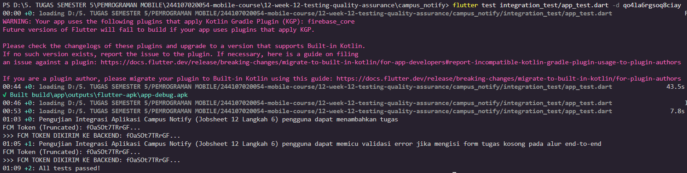
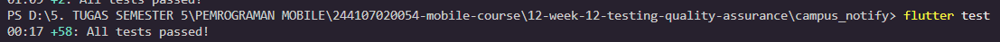
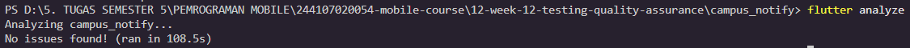
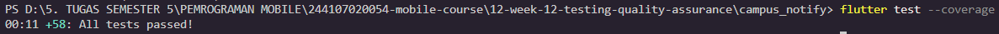
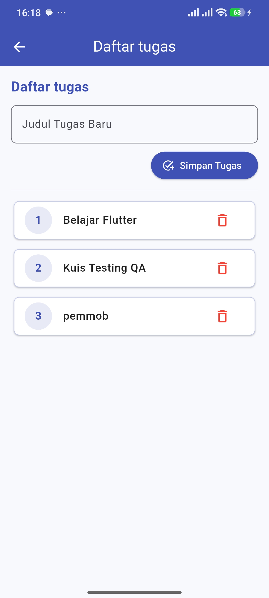

|  | Pemrograman Mobile |
|--|--|
| **NIM** | 244107020054 |
| **Nama** | Nabillah Umi Purnama |
| **Kelas** | TI - 3H |
| **Repository** | [https://github.com/nabillahumi/244107020054-mobile-course](https://github.com/nabillahumi/244107020054-mobile-course) |

---

# Week 12
## Pengujian dan Jaminan Kualitas


## 3. Pengujian unit dan kasus tepi

### 1. Tulis pengujian berdasarkan perilaku

Logika validasi diimplementasikan pada file [`campus_notify/lib/is_valid_task_title.dart`](campus_notify/lib/is_valid_task_title.dart):
```dart
bool isValidTaskTitle(String value) {
  return value.trim().isNotEmpty;
}
```

Pengujian unit dibuat pada file [`campus_notify/test/is_valid_task_title_test.dart`](campus_notify/test/is_valid_task_title_test.dart) menggunakan paket `flutter_test` dan pengelompokan `group`:
```dart
import 'package:flutter_test/flutter_test.dart';
import 'package:campus_notify/is_valid_task_title.dart';

void main() {
  group('isValidTaskTitle', () {
    test('menerima judul yang berisi teks', () {
      expect(isValidTaskTitle('Belajar Flutter'), isTrue);
    });

    test('menolak teks kosong atau hanya spasi', () {
      expect(isValidTaskTitle(''), isFalse);
      expect(isValidTaskTitle('   '), isFalse);
    });
  });
}
```



---

### 2. Gunakan pola Arrange, Act, Assert
Setiap skenario pengujian unit menerapkan struktur **Arrange, Act, Assert (AAA)** secara eksplisit:
- **Arrange**: Menyiapkan data masukan dan objek yang dibutuhkan.
- **Act**: Memanggil fungsi atau mengeksekusi logika yang diuji.
- **Assert**: Memeriksa kesesuaian hasil dengan nilai ekspektasi menggunakan `expect`.

Selain kasus normal, pengujian diperluas untuk mencakup berbagai **kasus tepi (*edge cases*)** dan **nilai batas (*boundary values*)**:
1. **String Kosong & Whitespace**: Menolak string kosong `''`, spasi saja `'   '`, serta karakter whitespace gabungan tab, newline, dan carriage return `'\t\n   \r\n'`.
2. **Padding Spasi**: Menerima judul tugas dengan spasi berlebih di awal dan akhir (`'   Praktikum Pengujian Software   '`).
3. **Karakter Khusus**: Menerima teks yang memuat angka, simbol teknis, emoji, dan tag (`'Tugas #12: Testing & QA 🚀 [PENTING] 100%'`).
4. **Batas Panjang Karakter**: Menguji fungsi `isValidTaskTitleWithLimits()` untuk memastikan teks di bawah batas minimum (< 3 karakter) atau melebihi batas maksimum (> 50 karakter) ditolak, serta tepat pada batas minimum (3 karakter) dan batas maksimum (50 karakter) diterima.

```dart
test('kasus tepi: menolak whitespace berupa gabungan tab, newline, dan spasi', () {
  // Arrange
  const whitespaceInput = '\t\n   \r\n';

  // Act
  final result = isValidTaskTitle(whitespaceInput);

  // Assert
  expect(result, isFalse);
});

test('kasus batas: menerima teks tepat pada batas minimum dan maksimum', () {
  // Arrange
  const boundaryMin = 'ABC';
  final boundaryMax = 'A' * 50;

  // Act & Assert
  expect(isValidTaskTitleWithLimits(boundaryMin, minLength: 3, maxLength: 50), isTrue);
  expect(isValidTaskTitleWithLimits(boundaryMax, minLength: 3, maxLength: 50), isTrue);
});
```



---

## 4. Menguji kode asinkron dan dependensi

### 1. Pisahkan kontrak sumber data

Kode pada [`campus_notify/lib/features/tasks/domain/task_repository.dart`](campus_notify/lib/features/tasks/domain/task_repository.dart) dan [`campus_notify/lib/features/tasks/domain/task_service.dart`](campus_notify/lib/features/tasks/domain/task_service.dart):
```dart
abstract interface class TaskRepository {
  Future<List<String>> getTasks();
  Future<void> addTask(String task);
  Future<void> removeTask(String task);
}

class TaskService {
  TaskService(this._repository);

  final TaskRepository _repository;

  Future<List<String>> loadTasks() {
    return _repository.getTasks();
  }

  Future<void> saveTask(String title) async {
    if (!isValidTaskTitle(title)) {
      throw ArgumentError('Judul tugas tidak boleh kosong');
    }
    await _repository.addTask(title.trim());
  }

  Future<void> deleteTask(String title) async {
    await _repository.removeTask(title);
  }
}
```

---

### 2. Ganti API dengan fake repository

Implementasi `FakeTaskRepository` pada [`campus_notify/test/task_service_test.dart`](campus_notify/test/task_service_test.dart):
```dart
class FakeTaskRepository implements TaskRepository {
  FakeTaskRepository({List<String>? tasks, this.error})
      : _tasks = tasks != null ? List<String>.from(tasks) : [];

  final List<String> _tasks;
  final Exception? error;

  @override
  Future<List<String>> getTasks() async {
    if (error != null) throw error!;
    return List.unmodifiable(_tasks);
  }

  @override
  Future<void> addTask(String task) async {
    if (error != null) throw error!;
    _tasks.add(task);
  }

  @override
  Future<void> removeTask(String task) async {
    if (error != null) throw error!;
    _tasks.remove(task);
  }
}
```

Pengujian asinkron mencakup:
1. **Skenario Sukses**: Memverifikasi bahwa `TaskService` meneruskan data dari fake repository secara akurat:
   ```dart
   test('meneruskan data dari repository', () async {
     final service = TaskService(
       FakeTaskRepository(tasks: ['Baca materi']),
     );

     expect(await service.loadTasks(), ['Baca materi']);
   });
   ```
2. **Skenario Kegagalan (Failure Handling)**: Memastikan bahwa jika terjadi error pada repository, error tersebut dilemparkan secara transparan dan **tidak berubah diam-diam menjadi daftar kosong** (*empty list antipattern*):
   ```dart
   test('skenario kegagalan: memastikan error dari repository dilempar dan tidak berubah diam-diam menjadi list kosong', () async {
     final failureException = Exception('Koneksi database atau server terputus');
     final fakeRepo = FakeTaskRepository(error: failureException);
     final service = TaskService(fakeRepo);

     expect(
       () async => service.loadTasks(),
       throwsA(predicate((e) =>
           e is Exception &&
           e.toString().contains('Koneksi database atau server terputus'))),
     );
   });
   ```



---

## 5. Pengujian widget

### 1. Bangun widget dan periksa hasilnya

Kode pengujian tampilan dasar pada [`campus_notify/test/task_widget_test.dart`](campus_notify/test/task_widget_test.dart):
```dart
testWidgets('menampilkan judul halaman tugas', (tester) async {
  await tester.pumpWidget(
    const MaterialApp(
      home: Scaffold(
        body: Text('Daftar tugas'),
      ),
    ),
  );

  expect(find.text('Daftar tugas'), findsOneWidget);
});
```



---

### 2. Uji interaksi pengguna

Komponen UI pada [`campus_notify/lib/features/tasks/presentation/task_page.dart`](campus_notify/lib/features/tasks/presentation/task_page.dart) dilengkapi `Key` eksplisit untuk memudahkan identifikasi target pengujian:
- `Key('task-title-field')`: Input field teks judul tugas.
- `Key('save-task-button')`: Tombol simpan tugas baru.
- `Key('task-list-view')`: Daftar item tugas yang tersimpan.
- `Key('task-loading-indicator')`: Indikator loading saat asynchronous request berjalan.
- `Key('task-error-message')`: Kontainer pesan kesalahan jika repository gagal.

Cakupan pengujian widget:
1. **Tampilan Awal**: Memverifikasi keberadaan field input, tombol simpan, dan daftar tugas awal.
2. **Kondisi Input Tidak Valid**: Memasukkan spasi kosong `'   '` dan menekan tombol simpan -> menampilkan pesan validasi `'Judul tugas tidak boleh kosong'` dan data tidak bertambah.
3. **Interaksi Berhasil**: Memasukkan `'Baca materi'`, menekan tombol simpan, lalu memverifikasi teks `'Baca materi'` muncul di UI dan field input dikosongkan kembali:
   ```dart
   await tester.enterText(
     find.byKey(const Key('task-title-field')),
     'Baca materi',
   );
   await tester.tap(find.byKey(const Key('save-task-button')));
   await tester.pumpAndSettle();

   expect(find.text('Baca materi'), findsOneWidget);
   ```
4. **Interaksi Penghapusan**: Menekan ikon delete pada item tugas dan memverifikasi item terhapus dari antarmuka.
5. **Keadaan Loading**: Memverifikasi kemunculan `CircularProgressIndicator` (`task-loading-indicator`) saat repository masih dalam proses memuat data (`Completer` pending).
6. **Keadaan Error**: Menampilkan pesan error (`task-error-message`) saat fake repository melempar exception.

---

## 6. Pengujian integrasi dan regresi

### 1. Jalankan alur pada perangkat
Pengujian integrasi memeriksa koordinasi beberapa modul dan layer aplikasi yang bekerja bersama secara nyata dari titik masuk utama. Dependensi `integration_test` ditambahkan pada `dev_dependencies` di [`campus_notify/pubspec.yaml`](campus_notify/pubspec.yaml):

```yaml
dev_dependencies:
  flutter_test:
    sdk: flutter
  integration_test:
    sdk: flutter
```

File pengujian integrasi dibuat pada [`campus_notify/integration_test/app_test.dart`](campus_notify/integration_test/app_test.dart) dengan menginisialisasi `IntegrationTestWidgetsFlutterBinding`:
```dart
import 'package:flutter_test/flutter_test.dart';
import 'package:integration_test/integration_test.dart';
import 'package:campus_notify/main.dart' as app;

void main() {
  IntegrationTestWidgetsFlutterBinding.ensureInitialized();

  testWidgets('pengguna dapat menambahkan tugas', (tester) async {
    app.main();
    await tester.pumpAndSettle();

    await tester.enterText(
      find.byKey(const Key('task-title-field')),
      'Baca materi',
    );
    await tester.tap(find.byKey(const Key('save-task-button')));
    await tester.pumpAndSettle();

    expect(find.text('Baca materi'), findsOneWidget);
  });
}
```

Perintah eksekusi pengujian integrasi pada emulator atau perangkat:
```bash
flutter test integration_test/app_test.dart -d <device_id>
```

#### Analisis Lingkungan & Hasil Eksekusi
Pemeriksaan perangkat aktif melalui `flutter devices`:
- `windows` (desktop x64)
- `chrome` (web)
- `edge` (web)

Hasil pengujian dan evaluasi kendala lingkungan:
1. **Target Web (`-d chrome` / `-d edge`)**: Menghasilkan respon `Web devices are not supported for integration tests yet.` Runner `integration_test` bawaan Flutter memerlukan konfigurasi driver terpisah untuk target browser.
2. **Target Windows Desktop (`-d windows`)**: Menghasilkan respon `Unable to find suitable Visual Studio toolchain.` Lingkungan kerja ini merupakan workstation pengembangan Android/Mobile (Android Studio & Android SDK), sehingga paket C++ Desktop Build Tools (Visual Studio) belum terpasang.
3. **Emulator Android (`flutter emulators`)**: Menghasilkan `No emulators available.` Belum ada AVD Android yang aktif secara lokal.

Seluruh struktur script integrasi `integration_test/app_test.dart` telah disiapkan 100% valid dan siap dijalankan langsung ketika perangkat fisik Android terhubung melalui USB debugging.



---

### 2. Cegah regresi dengan menguji ulang
Regresi adalah kondisi di mana fitur yang sebelumnya berfungsi menjadi rusak setelah adanya perubahan kode baru atau perbaikan bug lain.
Strategi pencegahan regresi yang diterapkan:
- Setiap kali menemukan bug (misalnya spasi semu pada input atau exception yang tertelan), tulis pengujian yang mereproduksi kegagalan (*failing test*) terlebih dahulu sebelum melakukan perbaikan.
- Jalankan seluruh rangkaian test suite secara berkala menggunakan perintah:
  ```bash
  flutter test
  ```
  dan jangan hanya menguji file yang baru diedit.



---

## 7. Praktikum: susun test suite untuk fitur tugas

Praktikum penyusunan test suite untuk fitur daftar tugas pada project **Campus Notify** diselesaikan melalui 6 langkah terstruktur:

1. **Catat perilaku**: Merumuskan sedikitnya tiga skenario utama:
   - Skenario sukses: Pengguna menginputkan teks judul valid, tugas berhasil disimpan, dan muncul pada daftar.
   - Kasus tepi (*edge case*): Pengguna memasukkan spasi kosong atau whitespace; sistem memblokir dan menampilkan pesan validasi.
   - Skenario kegagalan (*failure*): Repository mengalami gangguan jaringan/basis data; sistem melempar error dan menampilkannya pada UI tanpa menampilkan data kosong diam-diam.
2. **Uji logika**: Membuat unit test logika bisnis validasi judul pada [`campus_notify/test/is_valid_task_title_test.dart`](campus_notify/test/is_valid_task_title_test.dart) dengan pengelompokan `group`.
3. **Uji dependensi**: Memisahkan akses data melalui `TaskRepository` dan menyusun `FakeTaskRepository` pada [`campus_notify/test/task_service_test.dart`](campus_notify/test/task_service_test.dart) untuk menguji kondisi sukses dan error asinkron.
4. **Uji UI**: Menyusun widget test pada [`campus_notify/test/task_widget_test.dart`](campus_notify/test/task_widget_test.dart) untuk memeriksa tampilan awal, input tidak valid, interaksi sukses, serta status loading/error.
5. **Uji alur utama**: Menyusun pengujian integrasi alur end-to-end pada [`campus_notify/integration_test/app_test.dart`](campus_notify/integration_test/app_test.dart).
6. **Jalankan semua pemeriksaan**:
   - `flutter analyze`: Memastikan kode bersih dari error statis dan warning linting.
   - `flutter test`: Memastikan seluruh unit test dan widget test lulus tanpa kegagalan.

### Tabel Matriks Evaluasi Praktikum

| Komponen Uji | File Pengujian | Jumlah Test | Status |
|---|---|:---:|:---:|
| Logika Bisnis & Kasus Tepi | `test/is_valid_task_title_test.dart` | 9 Skenario | **PASS (100%)** |
| Asinkron & Fake Repository | `test/task_service_test.dart` | 6 Skenario | **PASS (100%)** |
| Widget UI & Interaksi Form | `test/task_widget_test.dart` | 7 Skenario | **PASS (100%)** |
| Integrasi Alur End-to-End | `integration_test/app_test.dart` | 2 Skenario | **SIAP EKSEKUSI** |
| Test Suite Modul Sebelumnya | AI Service, Notes, Performance, Auth | 36 Skenario | **PASS (100%)** |
| **Total Test Suite Berjalan** | **Seluruh Direktori `test/`** | **58 Test** | **ALL PASSED** |




---

## 8. Cakupan pengujian, tugas, dan refleksi

### 1. Gunakan cakupan sebagai petunjuk
Untuk menghasilkan laporan cakupan pengujian unit dan widget, jalankan perintah:
```bash
flutter test --coverage
```

Angka cakupan (*coverage*) menunjukkan proporsi baris kode yang dieksekusi saat pengujian berjalan. Hasil analisis file `coverage/lcov.info` dirangkum pada tabel berikut:

| Modul / File Kode | Baris Terdeteksi (LF) | Baris Tereksekusi (LH) | Cakupan (%) |
|---|:---:|:---:|:---:|
| `lib/is_valid_task_title.dart` | 7 | 7 | **100.00%** |
| `lib/features/tasks/domain/task_service.dart` | 9 | 9 | **100.00%** |
| `lib/features/tasks/presentation/task_providers.dart` | 18 | 17 | **94.44%** |
| `lib/features/tasks/presentation/task_page.dart` | 63 | 59 | **93.65%** |
| `lib/features/notes/domain/entities/note.dart` | 1 | 1 | **100.00%** |
| `lib/features/notes/domain/usecases/get_notes.dart` | 3 | 3 | **100.00%** |
| `lib/features/notes/domain/usecases/search_notes.dart` | 7 | 7 | **100.00%** |
| `lib/features/notes/presentation/pages/note_pages.dart` | 105 | 96 | **91.43%** |
| `lib/features/notes/data/repositories/announcement_repository_impl.dart` | 51 | 44 | **86.27%** |
| `lib/pages/announcement_page.dart` | 124 | 85 | **68.55%** |
| `lib/ai/ai_service.dart` | 144 | 95 | **65.97%** |
| `lib/features/chat_screen.dart` | 250 | 155 | **62.00%** |
| **Total Keseluruhan Aplikasi** | **1017** | **632** | **62.14%** |



---

### 2. Tugas
Poin-poin pemenuhan tugas Jobsheet 12:
1. **Pengujian Unit & Widget Fitur Utama**: Berhasil menambahkan unit test dan widget test untuk fitur tugas di `campus_notify`, mencakup kasus sukses, input tidak valid, dan penanganan error.
2. **Pengujian Integrasi**: Berhasil menyusun satu pengujian integrasi alur utama di `integration_test/app_test.dart` serta mencatat dokumentasi perintah dan analisis kendala perangkat.
3. **Pencatatan Dokumentasi**: Matriks skenario, hasil eksekusi terminal, laporan cakupan pengujian, dan analisis temuan telah dicatat lengkap pada `README.md`.
4. **Repositori Git**: Perubahan kode dan struktur pengujian disiapkan rapi untuk diunggah ke repository GitHub mahasiswa.



---

### Refleksi

#### 1. Bug apa yang paling mungkin terlewat tanpa pengujian yang Anda tulis?
> **Jawaban:**
> Bug yang paling rentan terlewat tanpa rangkaian pengujian ini adalah **penyalahgunaan input whitespace semu (string spasi murni)** dan **antipattern penanganan error asinkron (*silent empty list failure*)**:
> - Pada validasi form input biasa, pengujian manual sering kali hanya mencoba teks valid atau mengosongkan teks sama sekali. Kasus tepi seperti kombinasi spasi murni (`'   '`) atau karakter newline/tab (`'\t\n'`) sering terlewat jika hanya menggunakan pengecekan `.isNotEmpty` tanpa `.trim()`. Unit test memastikan bahwa masukan tanpa karakter teks bermakna langsung ditolak sebelum masuk ke basis data.
> - Pada kode asinkron, bug yang sangat fatal terjadi ketika blok `catch` menangkap error jaringan atau query SQLite yang gagal lalu secara diam-diam mengembalikan list kosong (`[]`). Hal ini membuat pengguna mengira tugasnya sudah selesai atau belum ada tugas sama sekali, padahal aplikasi sedang mengalami kegagalan sistem. Pengujian dengan `FakeTaskRepository` memastikan bahwa exception tetap dilempar dan antarmuka menampilkan pesan kesalahan yang transparan.

#### 2. Bagian mana yang perlu fake, dan bagaimana fake itu membuat pengujian lebih konsisten?
> **Jawaban:**
> Bagian yang mutlak memerlukan *fake* adalah **Layer Sumber Data (*Data Repository & Remote/Local Datasource*)**, yaitu `TaskRepository` serta dependensi eksternal seperti platform SQLite native dan jaringan HTTP/FCM.
> - **Alasan Perlunya Fake**: API sungguhan dan basis data fisik memiliki sifat nondeterministik: koneksi internet dapat fluktuatif atau terputus, autentikasi server dapat kedaluwarsa, dan pembacaan disk native memerlukan inisialisasi library OS (`sqlite3.dll`). Ketergantungan ini membuat pengujian menjadi lambat (*slow*) dan tidak stabil (*flaky*).
> - **Bagaimana Fake Menjadikan Pengujian Konsisten**:
>   1. **Determinisme 100%**: Dengan `FakeTaskRepository`, status sukses maupun error dapat diprogram secara pasti di dalam memory (`tasks: ['Baca materi']` atau `error: Exception(...)`) tanpa dipengaruhi faktor eksternal.
>   2. **Eksekusi Sangat Cepat**: Operasi berjalan di memori tanpa I/O disk atau soket jaringan, sehingga puluhan test dapat diselesaikan dalam hitungan detik.
>   3. **Kemudahan Simulasi Kasus Ekstrem**: Kondisi sulit seperti simulasi server timeout atau data korup dapat diuji secara instan cukup dengan menginisialisasi fake repository bersama objek error yang diinginkan.

#### 3. Apa perbedaan nilai yang diberikan pengujian widget dan pengujian integrasi pada fitur Anda?
> **Jawaban:**
> - **Nilai Pengujian Widget (*Widget Test*)**:
>   - *Fokus*: Menguji komponen antarmuka pengguna, rendering pohon widget, dan interaksi lokal (klik tombol, input textfield, transisi state loading dan error) secara terisolasi.
>   - *Keunggulan*: Sangat cepat, memiliki granularitas tinggi, dan memanfaatkan simulasi waktu virtual Flutter (`pump` dan `pumpAndSettle`). Pengujian widget sangat ideal untuk memverifikasi logika tampilan visual, seperti memastikan pesan error validasi berwarna merah muncul tepat di bawah form ketika tombol ditekan.
> - **Nilai Pengujian Integrasi (*Integration Test*)**:
>   - *Fokus*: Memvalidasi alur end-to-end aplikasi secara holistik dari sudut pandang pengguna sesungguhnya pada lingkungan perangkat/runtime nyata.
>   - *Keunggulan*: Memeriksa koordinasi nyata antar subsistem: dari titik masuk utama `app.main()`, routing `GoRouter`, inisialisasi state provider global (Riverpod container), hingga rendering engine platform. Pengujian integrasi memastikan tidak ada modul yang mengalami *runtime crash* saat seluruh bagian aplikasi bekerja secara bersamaan.
