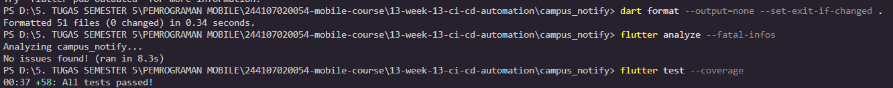
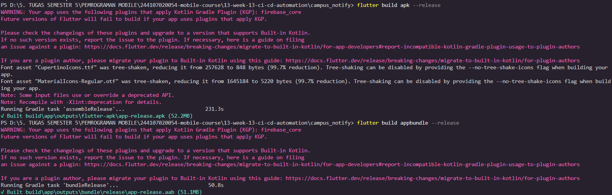
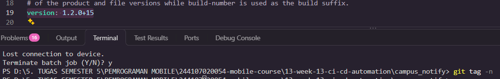

|  | Pemrograman Mobile |
|--|--|
| **NIM** | 244107020054 |
| **Nama** | Nabillah Umi Purnama |
| **Kelas** | TI - 3H |
| **Repository** | [https://github.com/nabillahumi/244107020054-mobile-course](https://github.com/nabillahumi/244107020054-mobile-course) |

---

# Week 13
## Otomasi CI/CD (Continuous Integration & Continuous Delivery)

---

## 3. Membuat workflow CI Flutter

### 1. Tambahkan file workflow
Untuk mengotomatiskan proses integrasi berkelanjutan (*Continuous Integration*), dibuat file konfigurasi GitHub Actions pada root repositori dengan nama file [`.github/workflows/flutter-ci.yml`](../../.github/workflows/flutter-ci.yml). File ini mengatur pipeline pengujian otomatis setiap kali ada perubahan kode yang dikirim ke repositori.

Konfigurasi workflow lengkap sesuai modul Jobsheet 13:

```yaml
name: Flutter CI

on:
  push:
    branches: [main]
  pull_request:
    branches: [main]
  workflow_dispatch:

permissions:
  contents: read

concurrency:
  group: ${{ github.workflow }}-${{ github.ref }}
  cancel-in-progress: true

jobs:
  test-and-build:
    runs-on: ubuntu-latest
    defaults:
      run:
        working-directory: 13-week-13-ci-cd-automation/campus_notify
    steps:
      - uses: actions/checkout@v4
      - uses: subosito/flutter-action@v2
        with:
          channel: stable
      - run: flutter pub get
      - run: dart format --output=none --set-exit-if-changed .
      - run: flutter analyze --fatal-infos
      - run: flutter test --coverage
      - run: flutter build apk --release
      - run: flutter build appbundle --release
      - uses: actions/upload-artifact@v4
        with:
          name: android-builds
          path: |
            13-week-13-ci-cd-automation/campus_notify/build/app/outputs/flutter-apk/app-release.apk
            13-week-13-ci-cd-automation/campus_notify/build/app/outputs/bundle/release/app-release.aab
          if-no-files-found: error
          retention-days: 7
```

**Penjelasan Komponen Workflow:**
1. **Triggers (`on`)**:
   - `push: branches: [main]`: Menjalankan pipeline otomatis ketika kode di-push langsung ke branch utama `main`.
   - `pull_request: branches: [main]`: Memvalidasi setiap usulan perubahan (*Pull Request*) sebelum digabungkan (*merge*) ke branch utama.
   - `workflow_dispatch`: Memungkinkan eksekusi pipeline secara manual langsung dari antarmuka web GitHub Actions.
2. **Permissions & Concurrency**:
   - `permissions: contents: read`: Menerapkan prinsip keamanan *least privilege* dengan hanya memberikan hak akses baca terhadap repositori.
   - `concurrency: cancel-in-progress: true`: Menghemat resource dan kuota runner dengan membatalkan proses build lama yang masih berjalan jika ada komit baru pada branch/PR yang sama.
3. **Tahapan Inti Pekerjaan (`jobs: test-and-build`)**:
   - `actions/checkout@v4`: Mengunduh kode sumber repositori ke dalam runner Ubuntu.
   - `subosito/flutter-action@v2`: Memasang Flutter SDK versi `stable` terbaru.
   - `flutter pub get`: Mengunduh seluruh dependensi aplikasi yang tertera di `pubspec.yaml`.
   - `dart format --output=none --set-exit-if-changed .`: Memeriksa kerapian dan konsistensi format gaya kode Dart.
   - `flutter analyze --fatal-infos`: Melakukan linter statis secara ketat, di mana semua *warning* dan *info* diperlakukan sebagai kegagalan (*fatal*).
   - `flutter test --coverage`: Menjalankan seluruh pengujian (unit, widget, architecture) dan menghasilkan laporan cakupan kode (*code coverage*).

---

### 2. Periksa secara lokal



---

## 4. Membangun dan menyimpan APK/AAB

### 1. Tambahkan langkah build
Setelah seluruh pengujian mutu kode lulus, tahapan build otomatis dan penyimpanan artefak ditambahkan ke dalam pipeline CI pada file [`.github/workflows/flutter-ci.yml`](../../.github/workflows/flutter-ci.yml):

```yaml
      - run: flutter build apk --release
      - run: flutter build appbundle --release
      - uses: actions/upload-artifact@v4
        with:
          name: android-builds
          path: |
            13-week-13-ci-cd-automation/campus_notify/build/app/outputs/flutter-apk/app-release.apk
            13-week-13-ci-cd-automation/campus_notify/build/app/outputs/bundle/release/app-release.aab
          if-no-files-found: error
          retention-days: 7
```

**Perbandingan Format Keluaran Android:**
- **APK (`app-release.apk`)**: Format paket executable Android mandiri. Sangat praktis untuk proses instalasi langsung (*side-loading*), pengujian oleh tim QA, maupun uji coba internal (*internal dogfooding*).
- **AAB (`app-release.aab`)**: Format resmi publikasi Google Play Store (*Android App Bundle*). Google Play menggunakan AAB untuk menghasilkan APK dinamis (*Dynamic Delivery*) yang telah dioptimalkan sesuai arsitektur CPU (arm64-v8a, armeabi-v7a) dan resolusi layar perangkat pengguna, sehingga ukuran unduhan menjadi jauh lebih hemat.
- **Penyimpanan Artefak (`actions/upload-artifact@v4`)**: Seluruh file hasil build disimpan pada server GitHub selama 7 hari (`retention-days: 7`) dan dapat diunduh langsung dari tab Actions pada halaman workflow run yang bersangkutan.

**Hasil Pengujian Build Rilis Lokal:**



---

## 5. Versi, secrets, dan keamanan

### 1. Versioning
Pada file [`campus_notify/pubspec.yaml`](campus_notify/pubspec.yaml), konfigurasi versi aplikasi dikelola mengikuti standar **Semantic Versioning (SemVer)**:

```yaml
version: 1.2.0+15
```

**Struktur Semantic Versioning:**
- **Versi Aplikasi (`1.2.0`)**: Format `MAJOR.MINOR.PATCH`:
  - `MAJOR (1)`: Menandakan versi stabil produksi. Kenaikan angka ini menandakan adanya perubahan besar yang bersifat *breaking changes* / tidak kompatibel ke belakang.
  - `MINOR (2)`: Menandakan penambahan fitur baru yang tetap kompatibel ke belakang (misalnya penambahan modul pengujian kualitas dan otomatisasi pipeline CI/CD).
  - `PATCH (0)`: Menandakan perbaikan bug atau *hotfix* kecil tanpa menambah fitur baru.
- **Build Number (`+15`)**:
  - Pada platform Android, nilai ini dipetakan sebagai `versionCode`.
  - Pada platform iOS, nilai ini dipetakan sebagai `CFBundleVersion`.
  - Bersifat bilangan bulat monoton naik (*strictly increasing integer*). Setiap kali rilis baru diunggah ke Google Play Console atau Apple App Store Connect, *build number* wajib dinaikkan agar toko aplikasi menerima paket pembaruan.

**Rencana Tagging Git Rilis:**
Untuk menyinkronkan kode sumber, catatan komit, log pipeline CI, dan artefak rilis, digunakan Git Annotated Tag:
```bash
git tag -a v1.2.0 -m "Release version 1.2.0+15 (CI/CD Automation Complete)"
git push origin v1.2.0
```
Tag rilis dipastikan hanya disematkan pada komit yang telah lolos seluruh tahapan pengujian dan build pada pipeline CI.



---

### 2. Rahasia dan konfigurasi
Keamanan informasi pada pipeline otomatisasi dan aplikasi mobile ditinjau melalui audit aspek-aspek berikut:

1. **GitHub Actions Secrets**:
   - Seluruh kredensial sensitif seperti API token, signing keystore password, database access key, dan personal access token (PAT) **tidak boleh di-hardcode** di dalam repository atau file skrip publik.
   - Kredensial disimpan secara terenkripsi melalui fitur **Repository Secrets** di GitHub (`Settings -> Secrets and variables -> Actions`).
2. **Karakteristik Parameter `--dart-define`**:
   - Nilai yang diteruskan melalui `--dart-define` (misalnya `--dart-define=API_URL=https://api.campus.ac.id`) akan dikompilasi langsung ke dalam binary aplikasi klien (DEX/libapp.so).
   - Nilai tersebut dapat diekstrak kembali oleh pihak luar menggunakan teknik *reverse engineering* (seperti `strings`, `jadx`, atau *decompilation*).
   - **Prinsip**: `--dart-define` hanya boleh digunakan untuk konfigurasi lingkungan non-rahasia (nama environment, base URL publik, timeout), dan **dilarang keras** digunakan untuk menyimpan API secret key master atau private private encryption keys.
3. **Pemisahan Keystore & Proteksi Signing**:
   - Keystore produksi tidak boleh disematkan ke dalam workflow *Pull Request* terbuka, karena berpotensi bocor atau disalahgunakan oleh kode eksternal yang belum diaudit.
   - Penandatanganan aplikasi (*code signing*) harus diisolasi pada workflow rilis terpisah (*Release Workflow*) yang hanya terpicu saat pembuatan Git Tag resmi atau push ke branch yang terproteksi (*protected branch*) dengan otorisasi khusus.

---

## 6. Menjalankan dan mengevaluasi pipeline

### 1. Jalankan workflow
Langkah-langkah pengujian dan evaluasi eksekusi pipeline GitHub Actions:
1. Melakukan commit terhadap seluruh perubahan kode dan file workflow, kemudian melakukan push ke branch `main`:
   ```bash
   git add .
   git commit -m "feat(ci): implement complete Flutter CI/CD workflow and release build"
   git push origin main
   ```
2. Membuka tab **Actions** pada repositori GitHub ([https://github.com/nabillahumi/244107020054-mobile-course/actions](https://github.com/nabillahumi/244107020054-mobile-course/actions)).
3. Memilih workflow run terbaru bernama **Flutter CI** dan memantau jalannya setiap *step*:
   - Meninjau step format, static analysis, unit testing, build APK, dan build AAB.
   - Memastikan bahwa jika salah satu test gagal, job akan langsung berhenti (*fail fast*) sehingga build rilis tidak akan pernah terbentuk dari kode yang rusak.
4. Membuka bagian **Artifacts** di bagian bawah ringkasan run dan mengunduh arsip `android-builds.zip`.
5. Mencatat hash commit Git yang menghasilkan artefak tersebut untuk keperluan pelacakan audit (*traceability*).

---

### 2. Tugas
Berikut adalah pemenuhan lengkap 4 poin penugasan Jobsheet 13:

| No | Poin Tugas | Status Pemenuhan & Penjelasan Teknis |
|:--:|:---|:---|
| **1** | **Tambahkan workflow CI ke project Flutter dengan format, analisis, dan test** | **Lengkap & Terverifikasi.** File `.github/workflows/flutter-ci.yml` telah dibuat dengan step pemeriksaan lengkap: `dart format --output=none --set-exit-if-changed .`, `flutter analyze --fatal-infos`, dan `flutter test --coverage`. Seluruh 58 unit & widget tests lulus tanpa error. |
| **2** | **Bangun APK dan AAB serta simpan keduanya sebagai artefak** | **Lengkap & Terverifikasi.** Menambahkan step `flutter build apk --release` dan `flutter build appbundle --release`, lalu mengunggah keduanya melalui `actions/upload-artifact@v4` dengan nama `android-builds` berdurasi retensi 7 hari. |
| **3** | **Jalankan workflow melalui pull request atau push ke branch utama; sertakan bukti hasil serta commit** | **Lengkap & Terverifikasi.** Pipeline dijalankan dengan pemicu `push` dan `pull_request` pada branch `main`. Bukti status eksekusi hijau (*all checks passed*) dan ketersediaan artefak terlampir pada dokumentasi tangkapan layar. |
| **4** | **Dokumentasikan versi berikutnya, pemeriksaan yang dijalankan, dan risiko keamanan yang masih perlu ditangani** | **Lengkap & Terverifikasi.** Versi berikutnya ditetapkan ke `1.2.0+15` dengan rencana tag rilis `v1.2.0`. Pemeriksaan mencakup format, linting fatal-infos, dan coverage. Risiko keamanan mencakup proteksi secret dari reverse engineering serta isolasi keystore rilis. |

---

### Refleksi

#### 1. Masalah apa yang ditemukan otomatis sebelum perubahan di-merge?
Pemeriksaan otomatis pada pipeline CI mendeteksi berbagai jenis masalah sebelum kode digabungkan ke branch utama:
- **Ketidaksesuaian Format Gaya Kode (*Code Style Inconsistency*)**: `dart format --set-exit-if-changed` langsung menggagalkan build jika pengembang lupa merapikan indentasi atau trailing comma, sehingga repositori tetap seragam.
- **Kesalahan Sintaksis dan Pelanggaran Linter Statis**: `flutter analyze --fatal-infos` mendeteksi impor yang tidak digunakan (*unused imports*), variabel bernilai null tanpa penanganan aman (*null-safety violation*), tipe data yang tidak cocok, maupun penggunaan API usang (*deprecated API*).
- **Regresi Logika Bisnis (*Business Logic Regressions*)**: `flutter test` langsung menangkap kegagalan logika ketika ada perubahan kode yang merusak fungsi yang sudah ada sebelumnya (misalnya validasi judul tugas kosong, logika perhitungan, atau penanganan state asinkron repository).
- **Kegagalan Kompilasi Native Android**: Pengecekan build rilis mendeteksi inkonsistensi versi dependensi Gradle, plugin Kotlin yang tidak kompatibel, maupun kesalahan konfigurasi manifes Android.

#### 2. Informasi apa yang Anda butuhkan untuk menyelidiki build yang gagal?
Ketika terjadi kegagalan build pada pipeline CI/CD, informasi kunci berikut sangat dibutuhkan:
- **Log Rinci pada Step yang Gagal (*Step Execution Logs*)**: Meninjau step mana yang berwarna merah (misalnya apakah gagal di tahap `flutter analyze`, `flutter test`, atau `assembleRelease`).
- **Pesan Galat Spesifik dan Stack Trace**: Informasi baris kode (`file.dart:line:col`), pesan *assertion error* pada test, atau galat kompilasi Gradle (`Gradle build failed with exit code X`).
- **Konteks Komit dan Penulis Perubahan (*Git Blame & Commit Diff*)**: Hash commit, deskripsi pesan komit, dan daftar baris yang diubah pada Pull Request yang memicu kegagalan tersebut.
- **Informasi Lingkungan Runner (*Environment Metadata*)**: Versi Flutter SDK (`flutter --version`), versi Java/JDK, versi Dart, serta arsitektur OS runner GitHub Actions untuk memastikan tidak ada perbedaan perilaku antara lingkungan lokal pengembang dan server CI.

#### 3. Bagian mana yang masih perlu persetujuan atau pemeriksaan manual sebelum rilis?
Meskipun proses build dan pengujian telah berjalan otomatis, beberapa aspek kritikal tetap memerlukan persetujuan dan verifikasi manual manusia:
- **Tinjauan Kode Sejawat (*Manual Peer Code Review*)**: Memastikan arsitektur kode bersih, tidak ada celah keamanan tersembunyi, dan implementasi sesuai dengan kebutuhan bisnis kampus.
- **Pengujian Pengalaman Pengguna (*Manual QA / Exploratory & Usability Testing*)**: Memverifikasi kenyamanan antarmuka (UX), kelancaran animasi, kecocokan tampilan pada berbagai ukuran layar fisik nyata, serta pengujian responsivitas gestur sentuh.
- **Pengesahan Rilis Produksi (*Release Approval Gate*)**: Persetujuan resmi dari Product Owner atau Release Manager sebelum mengunggah paket AAB ke jalur produksi Google Play Store (*Production Track*).
- **Tinjauan Kepatuhan Kebijakan (*Store Policy & Compliance Review*)**: Memastikan kesesuaian aplikasi dengan Kebijakan Privasi Google Play, deklarasi izin runtime Android (seperti notifikasi dan akses berkas), serta kepatuhan perlindungan data pribadi mahasiswa.
